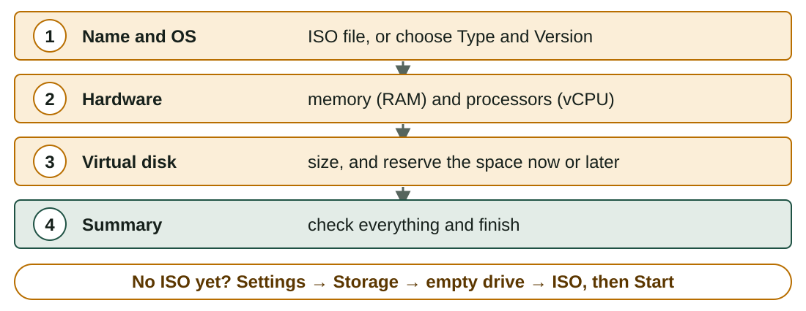
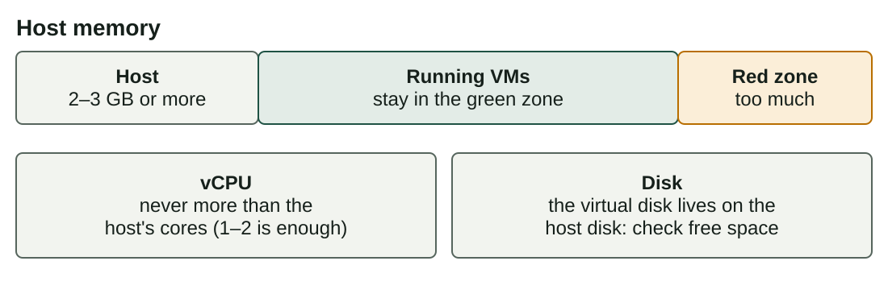

## What you will learn

:::pasos
- How to **install VirtualBox** and create a **VM** step by step
- How to choose its **CPU, memory and disk**
- The **virtual disk** formats and their **allocation**
- The **network modes** and who can talk to whom
- How a VM relates to the **host**
:::

---

## VirtualBox: a free Type 2 hypervisor

:::pasos
- Runs on **Windows, Linux and macOS** (Intel)
- **Free and open source**
- **VirtualBox Manager** (graphical) and `VBoxManage` (command line)
- Main buttons: **New**, **Settings**, **Start**, **Snapshots**
- Macs with Apple chips use Arm: the **guests must be Arm** too
- Alternatives: **VMware Workstation**, **Hyper-V**; only the menus change
:::

---

## Installing it

| Host | How |
|---|---|
| Windows | Official installer, default options |
| Ubuntu / Debian / LliureX | `sudo apt install virtualbox` |
| macOS (Intel) | Official disk image and installer |

Check that it works:

```bash
VBoxManage --version
```

---

## The Extension Pack is not VirtualBox

:::pasos
- A separate **add-on** with extra features, such as USB 2.0 and 3.0
- It has a **different licence**
- Free for **personal, educational and evaluation** use
- **Companies** have to pay for it
- Do not install it **unless you need it**
:::

---

## Creating a VM: four steps in the wizard

You need a name and type of OS, the hardware, and an installation source: an **ISO image**.



---

## Choose Type and Version with care

:::pasos
- VirtualBox uses them to pick **safe default settings**
- *Ubuntu (64-bit)* and then installing Windows: it may work **badly**
- **Enable EFI**: the VM starts with **UEFI**, not the old BIOS
:::

:::caution[Unattended installation]
VirtualBox 7 can install some systems by itself. Do the installation **yourself at least once** to see the installer: tick **Skip Unattended Installation**.
:::

---

## How much hardware does the guest need?

Typical minimum values from each system's official documentation:

| Guest | vCPU | RAM | Disk |
|---|---|---|---|
| Ubuntu 24.04 Desktop | 2 | 4 GB | 25 GB |
| Windows 11 | 2 | 4 GB | 64 GB |

:::pasos
- Windows 11 also needs **UEFI with Secure Boot** and **TPM 2.0**
- VirtualBox 7 can provide both: check **Settings → System**
:::

---

## The same choices as a physical computer

| On a physical computer you choose… | In VirtualBox you choose… |
|---|---|
| The processor and cores | **System → Processor**: number of vCPUs |
| The memory modules | **System → Motherboard**: base memory |
| The disk | **Storage**: a virtual disk file |
| The network card | **Network**: adapter and mode |
| The DVD drive | **Storage**: an ISO file or the host drive |

---

## Do not over-assign

The host keeps working while the VMs run, so leave resources for it.



---

## A virtual disk is a file on the host

:::pasos
- **VDI**: the VirtualBox format, the default
- **VMDK**: from VMware; also used in OVA packages
- **VHD**: from Microsoft; used by Hyper-V and Windows
- The format matters less than the **allocation**
:::

---

## Dynamic or fixed size?

| | Dynamically allocated | Fixed size |
|---|---|---|
| Space on the host | Starts small, grows as the guest writes | All reserved at creation |
| Creation | Instant | It takes some time |
| Speed | Usually a bit lower while it grows | More predictable |
| Risk | The host can run out of space | None: the space is already yours |
| Typical use | Classroom and tests | Servers, benchmarks |

---

## A dynamic disk does not shrink by itself

::::columnas


:::pasos
- A 50 GB dynamic disk with 8 GB of data uses **about 8 GB**
- When the guest deletes files, the file **stays the same size**
- To recover the space, **compact** the disk with a special tool
:::
::::

---

## Five network modes

Each VM has up to four adapters, and each one works in a **mode**.

| Mode | What it does | Typical use |
|---|---|---|
| **NAT** | Shares the host IP: the VM goes out, nobody comes in | Default: browsing, updates |
| **Bridged adapter** | Own address on the real network | A server others must reach |
| **Host-only adapter** | Private network of host and VMs; no Internet | A safe lab |
| **Internal network** | Private network of VMs only; not even the host | Fully isolated labs |
| **NAT Network** | Like NAT, but VMs share a network and see each other | VMs that see each other and go out |

---

## Who can talk to whom?


---

## Two classroom traps

:::caution[Bridged mode in schools and Wi-Fi]
Many school and public networks do not give an address to the VM, and some Wi-Fi adapters fail. If it does not work, use **NAT** or another network.
:::

:::pasos
- Every network card has a **MAC address**, unique in the network
- A cloned or imported VM may keep the **same MAC** as the original
- Always **generate new MAC addresses** in a classroom
:::

---

## A VM is a set of files and a process

:::pasos
- The **`.vbox`** file describes the virtual hardware
- The disk files (**`.vdi`**…) hold the data
- Running, VirtualBox is a **process** of the host using its CPU and memory
- Closing the window: **save the state**, **send the shutdown signal** or **power off**
- **Power off** is like pulling the plug: it can damage the guest file system
:::

---

## Control a VM from the terminal

```bash
VBoxManage list vms                      # all registered VMs
VBoxManage list runningvms               # VMs that are running
VBoxManage showvminfo "SOM-U2-Ubuntu"    # full configuration
VBoxManage modifyvm "SOM-U2-Ubuntu" --memory 2048 --cpus 2
VBoxManage startvm "SOM-U2-Ubuntu"
```

The VM must be **powered off** to change the memory or the processors.

---

## Try it yourself

::laboratorio[New VM wizard]{src="virtualizacion" pestana="wizard"}

::laboratorio[Network modes]{src="virtualizacion" pestana="network"}

---

## Summary

- **VirtualBox** is a free **Type 2** hypervisor; the **New** wizard creates a VM
- Give the guest **what it needs** and leave resources for the **host**
- A **dynamic** disk grows; a **fixed** disk is reserved at creation
- **NAT** is the default; bridged, host-only, internal and NAT Network
- Generate **new MAC addresses** when you clone or import

[Activities of the unit →](/docencia/smr/som/ud02-virtualizacion/actividades/)

---

## Credits

These slides summarise the SOM course notes by Moisés Mas Rocamora, Daniel Álvarez Santamaría and Jana Taboada León, licensed under **CC BY-NC-SA 4.0**. They are shared under the same licence.
