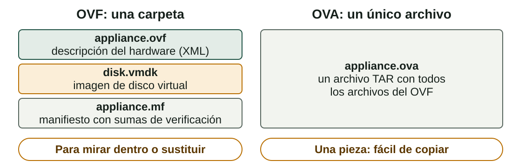
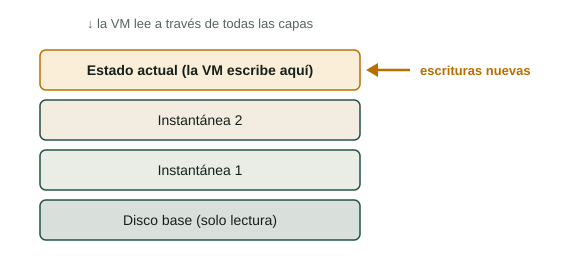
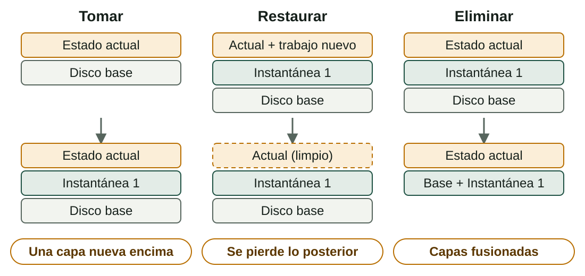
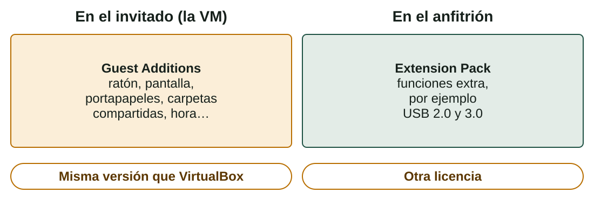

## Qué aprenderás

:::pasos
- Qué es una **aplicación virtual** y cómo **importar un OVA**
- Cómo funcionan las **instantáneas** y cómo usarlas como **red de seguridad**
- Cómo instalar las **Guest Additions**
- Cómo compartir el **portapapeles** y **carpetas**
:::

---

## Una aplicación virtual es una VM lista para arrancar

:::pasos
- Ya **instalada, configurada y probada** por su autor
- Una «**imagen de referencia**»: solo tienes que **importarla**
- **Coherencia**: todos empiezan desde la misma máquina
- **Rapidez**: te saltas la instalación larga
- **Portabilidad**: se importa en cualquier sistema operativo anfitrión
- **Vuelta atrás**: toma una instantánea del estado limpio
:::

---

## OVF y OVA



```bash
tar -tvf appliance.ova    # lista el contenido de un OVA
```

---

## Verifica antes de importar

:::pasos
- Una **suma de verificación** es un código corto que identifica el contenido exacto de un archivo
- Igual a la publicada: el archivo está **completo y sin modificar**
- Distinta: **bórralo y descárgalo otra vez**
:::

```bash
sha256sum appliance.ova        # Linux
shasum -a 256 appliance.ova    # macOS
Get-FileHash .\appliance.ova -Algorithm SHA256    # Windows
```

---

## Importa solo aplicaciones en las que confíes

:::caution[Importa solo aplicaciones en las que confíes]
Una aplicación contiene un sistema que ha preparado otra persona: programas, usuarios y contraseñas que no conoces.

Usa aplicaciones de tu **profesor** o de la **web oficial** de un proyecto, nunca de una página cualquiera.
:::

---

## Importar un OVA

:::pasos
1. Guárdalo con **espacio libre** (el disco ocupa de 1,3 a 1,5 veces el OVA) y verifica la **suma de verificación**
2. **File → Import Appliance…**, selecciona el OVA, **Next**
3. Cambia el nombre de la VM, ajusta **CPU y RAM**, deja el primer adaptador en **NAT**
4. **MAC address policy**: genera **nuevas direcciones MAC**
5. Pulsa **Import** y espera: la VM aparece en la lista
6. **Arráncala**: el autor da el usuario y la contraseña (tu profesor, en Aules)
:::

---

## Comprobaciones tras el primer arranque

Abre un terminal dentro del invitado:

```bash
hostnamectl      # nombre de la máquina, sistema operativo y núcleo
ip a             # interfaces de red y direcciones
df -h            # discos y espacio libre
```

Una dirección como **10.0.2.15** en modo NAT significa que la VM tiene conexión.

---

## Línea de órdenes, exportar y Windows

```bash
VBoxManage import appliance.ova --vsys 0 --vmname "SOM-U2-Apellido"
VBoxManage modifyvm "SOM-U2-Apellido" --memory 2048 --cpus 2
```

:::pasos
- **Exporta** tu propia VM a un OVA: **File → Export Appliance…** o `VBoxManage export`
- Las **aplicaciones de Windows** son menos comunes: las licencias limitan su distribución
- Microsoft publica versiones de **evaluación con tiempo limitado**
:::

---

## Qué conserva una instantánea

Una instantánea es un punto de «guardar partida».

::::columnas


:::pasos
- La **configuración** de la VM
- El **estado del disco**: el archivo actual se congela y una **imagen diferencial** pequeña recibe los cambios
- El **estado de la memoria**, si la VM estaba en marcha
:::
::::

---

## Tomar, restaurar y eliminar



---

## Eliminar conserva tu trabajo; restaurar, no

:::pasos
- **Eliminar** quita el punto de control: las capas se **fusionan**, no se pierden datos
- Fusionar puede tardar y necesitar **espacio libre** temporal
- **Restaurar** descarta el trabajo hecho **después** de la instantánea
- VirtualBox puede hacer antes una instantánea del estado actual: **acepta si dudas**
- Las instantáneas forman un **árbol**: restaura una antigua y toma otra para crear una **rama**
:::

---

## Instantáneas desde el terminal

```bash
VBoxManage snapshot "SOM-U2-Apellido" take "baseline"
VBoxManage snapshot "SOM-U2-Apellido" list
VBoxManage snapshot "SOM-U2-Apellido" restore "baseline"
VBoxManage snapshot "SOM-U2-Apellido" delete "baseline"
```

---

## Buenas prácticas

:::pasos
- Una justo después de **importar o instalar** (`baseline`) y otra antes de cada **cambio arriesgado**
- **Nombres con sentido**: `before-lamp-install_2026-10-05`
- **Pocas instantáneas**: las cadenas largas usan más disco y ralentizan la VM
- Tómalas **con la VM apagada** si no necesitas los programas abiertos
- **Elimina** las que ya no necesites
- **No son una copia de seguridad**: exporta un OVA o clona (**Machine → Clone**)
:::

---

## Las Guest Additions hacen cómoda la VM

Un invitado recién instalado es torpe. Controladores y herramientas que instalas **dentro del invitado** lo arreglan:

:::pasos
- **Integración del ratón**: el puntero se mueve libremente
- **Resolución dinámica** y mejores controladores gráficos
- **Portapapeles compartido** y **arrastrar y soltar** (no siempre fiable)
- **Carpetas compartidas** y **sincronización de la hora**
- **Modo integrado**: ventanas del invitado en el escritorio del anfitrión
:::

Vienen en la imagen de CD `VBoxGuestAdditions.iso`.

---

## No es lo mismo que el Extension Pack



---

## Instalarlas en un invitado Linux

:::pasos
1. Arranca la VM e inicia sesión
2. Instala las herramientas para **compilar los controladores**
3. **Devices → Insert Guest Additions CD image…**
4. Ejecuta el **instalador** desde el CD virtual
5. **Reinicia** la VM
:::

```bash
sudo apt install build-essential dkms linux-headers-$(uname -r)
sudo sh /media/$USER/VBox_GAs_*/VBoxLinuxAdditions.run
```

---

## Instalarlas en un invitado Windows

:::pasos
1. Arranca la VM e inicia sesión
2. **Devices → Insert Guest Additions CD image…**
3. Abre el CD en el Explorador de archivos y ejecuta `VBoxWindowsAdditions.exe`; acepta los controladores
4. Termina el asistente y **reinicia**
:::

---

## Compartir el portapapeles y una carpeta

:::pasos
- Portapapeles: **Devices → Shared Clipboard → Bidirectional**
- Carpeta: **Devices → Shared Folders…**, marca **Auto-mount** y **Make Permanent**
- Windows: unidad `Z:` · Linux: `/media/sf_<nombre>`
- Linux con *permiso denegado*: `sudo usermod -aG vboxsf $USER`
:::

:::caution[Comodidad frente a seguridad]
Compartir rompe parte del aislamiento. Con archivos sospechosos, **desactívalo**; si no, comparte solo lo necesario, en **solo lectura** si puedes.
:::

---

## Resumen

- Una **aplicación virtual** es una VM lista: importa un **OVA**, **verifícalo** y confía en su origen
- Una **instantánea** es una capa: **restaurar** pierde lo posterior, **eliminar** lo conserva
- Una instantánea **no es una copia de seguridad**: exporta o clona
- Las **Guest Additions** van en el invitado; el **Extension Pack**, en el anfitrión

[Actividades de la unidad →](/docencia/smr/som/ud02-virtualizacion/actividades/es/)

---

## Créditos

Estas diapositivas resumen los apuntes del curso de SOM de Moisés Mas Rocamora, Daniel Álvarez Santamaría y Jana Taboada León, con licencia **CC BY-NC-SA 4.0**. Se comparten con la misma licencia.
