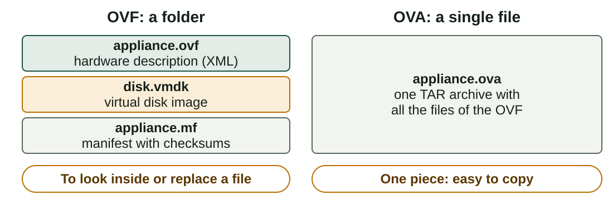
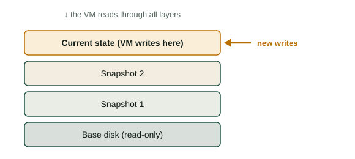
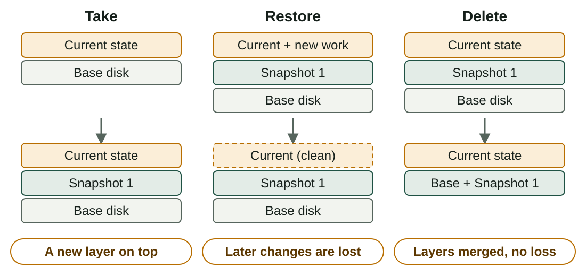
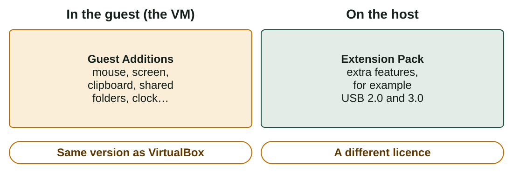

## What you will learn

:::pasos
- What a **virtual appliance** is and how to **import an OVA**
- How **snapshots** work and how to use them as a **safety net**
- How to install **Guest Additions**
- How to share the **clipboard** and **folders**
:::

---

## A virtual appliance is a VM ready to start

:::pasos
- Already **installed, configured and tested** by its author
- A "**golden image**": you only have to **import** it
- **Consistency**: everyone starts from the same machine
- **Speed**: you skip the long installation
- **Portability**: it imports on any host operating system
- **Rollback**: take a snapshot of the clean state
:::

---

## OVF and OVA



```bash
tar -tvf appliance.ova    # list the contents of an OVA
```

---

## Verify before you import

:::pasos
- A **checksum** is a short code that identifies a file's exact content
- Equal to the published one: the file is **complete and unchanged**
- Different: **delete it and download it again**
:::

```bash
sha256sum appliance.ova        # Linux
shasum -a 256 appliance.ova    # macOS
Get-FileHash .\appliance.ova -Algorithm SHA256    # Windows
```

---

## Only import appliances you trust

:::caution[Only import appliances you trust]
An appliance holds a system that someone else prepared: programs, users and passwords you do not know.

Use appliances from your **teacher** or from the **official site** of a project, never from a random website.
:::

---

## Importing an OVA

:::pasos
1. Save it with **free space** (the disk takes about 1.3 to 1.5 times the OVA) and verify the **checksum**
2. **File → Import Appliance…**, select the OVA, **Next**
3. Rename the VM, adjust **CPUs and RAM**, leave the first adapter in **NAT**
4. **MAC address policy**: generate **new MAC addresses**
5. Press **Import** and wait: the VM appears in the list
6. **Start** it: the author gives the user and password (your teacher, in Aules)
:::

---

## Checks after the first start

Open a terminal inside the guest:

```bash
hostnamectl      # machine name, operating system and kernel
ip a             # network interfaces and addresses
df -h            # disks and free space
```

An address like **10.0.2.15** in NAT mode means the VM has a connection.

---

## Command line, export and Windows

```bash
VBoxManage import appliance.ova --vsys 0 --vmname "SOM-U2-Surname"
VBoxManage modifyvm "SOM-U2-Surname" --memory 2048 --cpus 2
```

:::pasos
- **Export** your own VM to an OVA: **File → Export Appliance…** or `VBoxManage export`
- **Windows appliances** are less common: licence rules limit their distribution
- Microsoft publishes official **time-limited evaluation** versions
:::

---

## What a snapshot keeps

A snapshot is a "save game" point.

::::columnas


:::pasos
- The **configuration** of the VM
- The **disk state**: the current file is frozen and a small **differencing image** receives the changes
- The **memory state**, if the VM was running
:::
::::

---

## Take, restore and delete



---

## Delete keeps your work; restore does not

:::pasos
- **Delete** removes the checkpoint: the layers are **merged**, no data is lost
- Merging can take **time** and need temporary **free space**
- **Restore** discards the work done **after** the snapshot
- VirtualBox can first snapshot the current state: **accept if unsure**
- Snapshots form a **tree**: restore an old one and take another to create a **branch**
:::

---

## Snapshots from the terminal

```bash
VBoxManage snapshot "SOM-U2-Surname" take "baseline"
VBoxManage snapshot "SOM-U2-Surname" list
VBoxManage snapshot "SOM-U2-Surname" restore "baseline"
VBoxManage snapshot "SOM-U2-Surname" delete "baseline"
```

---

## Good practices

:::pasos
- One right after the **import or installation** (`baseline`) and one before every **risky change**
- **Meaningful names**: `before-lamp-install_2026-10-05`
- **Few snapshots**: long chains use more disk and slow the VM
- Take them **powered off** if you do not need the open programs
- **Delete** the ones you no longer need
- **Not a backup**: export an OVA or clone (**Machine → Clone**)
:::

---

## Guest Additions make the VM comfortable

A fresh guest is clumsy. Drivers and tools you install **inside the guest** fix it:

:::pasos
- **Mouse integration**: the pointer moves freely
- **Dynamic resolution** and better graphics drivers
- **Shared clipboard** and **drag and drop** (not always reliable)
- **Shared folders** and **time synchronisation**
- **Seamless mode**: guest windows on the host desktop
:::

They come in the CD image `VBoxGuestAdditions.iso`.

---

## Not the same as the Extension Pack



---

## Installing them in a Linux guest

:::pasos
1. Start the VM and log in
2. Install the tools to **compile the drivers**
3. **Devices → Insert Guest Additions CD image…**
4. Run the **installer** from the virtual CD
5. **Restart** the VM
:::

```bash
sudo apt install build-essential dkms linux-headers-$(uname -r)
sudo sh /media/$USER/VBox_GAs_*/VBoxLinuxAdditions.run
```

---

## Installing them in a Windows guest

:::pasos
1. Start the VM and log in
2. **Devices → Insert Guest Additions CD image…**
3. Open the CD in File Explorer and run `VBoxWindowsAdditions.exe`; accept the drivers
4. Finish the wizard and **restart**
:::

---

## Share the clipboard and a folder

:::pasos
- Clipboard: **Devices → Shared Clipboard → Bidirectional**
- Folder: **Devices → Shared Folders…**, tick **Auto-mount** and **Make Permanent**
- Windows: drive `Z:` · Linux: `/media/sf_<name>`
- Linux *permission denied*: `sudo usermod -aG vboxsf $USER`
:::

:::caution[Convenience against security]
Sharing breaks part of the isolation. With suspicious files, turn it **off**; otherwise share only what you need, **read-only** if you can.
:::

---

## Summary

- An **appliance** is a ready VM: import an **OVA**, **verify** it and trust its source
- A **snapshot** is a layer: **restore** loses later work, **delete** keeps it
- A snapshot is **not a backup**: export or clone
- **Guest Additions** go in the guest; the **Extension Pack** goes on the host

[Activities of the unit →](/docencia/smr/som/ud02-virtualizacion/actividades/)

---

## Credits

These slides summarise the SOM course notes by Moisés Mas Rocamora, Daniel Álvarez Santamaría and Jana Taboada León, licensed under **CC BY-NC-SA 4.0**. They are shared under the same licence.
