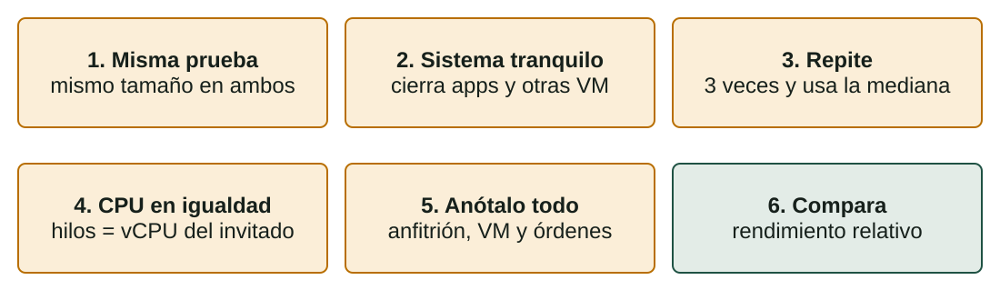
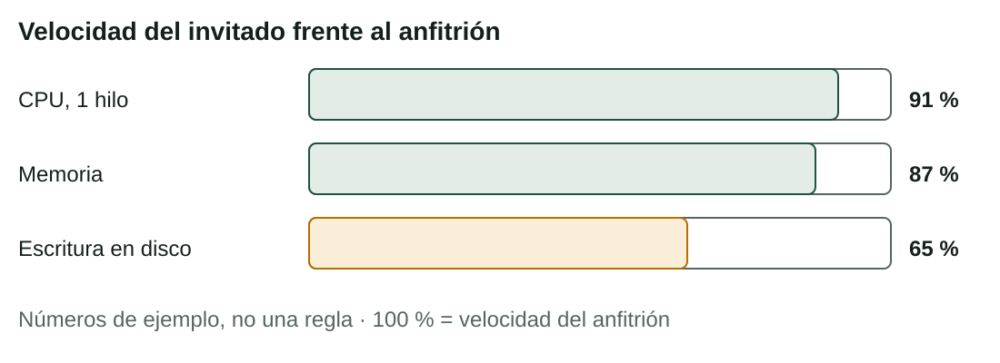

## Qué aprenderás

:::pasos
- Qué **esperar** de una VM: ¿**cuánto más lenta** es?
- Qué hace una VM **más lenta o más rápida**
- Un **método** para medir CPU, memoria y disco en el anfitrión y en el invitado
- Cómo **leer y explicar** los resultados con números
:::

---

## «Mi VM va lenta» no es una medida

:::pasos
- Una VM funciona en el **mismo hardware** que el anfitrión: no puede ser más rápida
- La pregunta es **cuánto más lenta**, y en qué tipo de trabajo
- Los números dependen de tu **procesador, disco, programas y ajustes**
- Por eso **medimos** en lugar de suponer
:::

---

## ¿Qué esperamos?

| Recurso | Qué ocurre en una VM | Diferencia típica |
|---|---|---|
| **CPU** | Con VT-x o AMD-V, la mayoría de las instrucciones se ejecutan directamente | Muy pequeña; a menudo el 90 % o más |
| **Memoria** | La paginación anidada (EPT/NPT) hace rápida la traducción de direcciones | Pequeña, si el anfitrión tiene suficiente |
| **Disco** | Cada petición pasa por una controladora virtual y el sistema de archivos del anfitrión | La mayor diferencia |
| **Red** | Una tarjeta virtual y la red del anfitrión | Pequeña en el uso normal |

---

## ¿Qué hace una VM más lenta o más rápida? (1/2)

| Factor | Efecto | Qué hacer |
|---|---|---|
| **Tipo de disco** | Un SSD cierra casi toda la diferencia | Guarda la VM en un SSD |
| **Virtualización por hardware** | Sin ella: mucho más lenta, o no arranca | Actívala en la UEFI/BIOS |
| **Demasiadas vCPU** | La VM espera a que haya núcleos libres | 1-2 vCPU, nunca más que los núcleos |
| **Poca RAM en el invitado** | El invitado usa el disco como memoria (*swap*) | Dale lo que necesita |
| **Demasiada RAM para el invitado** | El anfitrión usa el *swap* y todas las VM sufren | Deja 2-3 GB o más al anfitrión |

---

## ¿Qué hace una VM más lenta o más rápida? (2/2)

| Factor | Efecto | Qué hacer |
|---|---|---|
| **Cadenas largas de instantáneas** | Cada lectura puede mirar varias capas | Pocas instantáneas; borra las antiguas |
| **Reserva del disco** | Un disco dinámico tiene que crecer al escribir | Tamaño fijo para pruebas de rendimiento |
| **Otras VM y programas** | Compiten por CPU, memoria y disco | Sin tareas pesadas mientras mides |
| **Guest Additions** | Sin ellas, gráficos y ratón parecen lentos | Instálalas |
| **Controladora** | SATA/AHCI es una buena elección general | Deja la que viene por defecto |

---

## Cómo medir con justicia



---

## Rendimiento relativo

> rendimiento relativo (%) = resultado del invitado ÷ resultado del anfitrión × 100

:::pasos
- **Más es mejor** (operaciones por segundo, MB/s): invitado ÷ anfitrión × 100
- **Menos es mejor** (segundos): **tiempo del anfitrión ÷ tiempo del invitado** × 100
- Repite cada prueba **tres veces** y usa la **mediana**
:::

---

## Conoce primero tu sistema (Linux)

```bash
lscpu                       # modelo de procesador, núcleos, virtualización
nproc                       # número de CPU que puede usar el sistema
free -h                     # memoria total y libre
lsblk -d -o NAME,SIZE,ROTA  # discos; ROTA 1 = mecánico, 0 = SSD
systemd-detect-virt         # en una VM: el hipervisor («oracle»)
```

---

## Pruebas en Linux: CPU y memoria

```bash
sudo apt install sysbench
sysbench cpu --cpu-max-prime=20000 --threads=1 run
sysbench memory --memory-block-size=1M --memory-total-size=10G run
```

:::pasos
- CPU: **events per second** (más es mejor) o **total time** (menos es mejor)
- Repite con `--threads=2`, o tantos como **vCPU** tenga el invitado
- Memoria: **MiB transferidos por segundo** (más es mejor)
:::

---

## Pruebas en Linux: escritura en disco con dd

```bash
dd if=/dev/zero of=./test.tmp bs=1M count=1024 oflag=direct status=progress
rm ./test.tmp
```

- Escribe un **archivo de 1 GB** sin usar la caché, lo borra y muestra la velocidad en **MB/s**

:::caution[Cuidado con la ruta]
Escribe el archivo donde tengas **permiso** y espacio libre, y bórralo después.
:::

---

## Lecturas y escrituras aleatorias

```bash
sysbench fileio --file-total-size=2G prepare
sysbench fileio --file-total-size=2G --file-test-mode=rndrw --time=30 run
sysbench fileio --file-total-size=2G cleanup
```

Los mismos tres pasos en el anfitrión y en el invitado: **prepare**, **run**, **cleanup**.

---

## ¿Sin herramientas? Mide el tiempo

```bash
time sha256sum bigfile.iso       # CPU y lectura de disco
time cp bigfile.iso copy.iso     # lectura y escritura de disco
```

:::pasos
- `time` muestra `real`, `user` y `sys`
- Para comparar usa **`real`**: lo que esperas
:::

---

## Pruebas en Windows

:::pasos
- Prueba de rendimiento de **7-Zip**: *Tools → Benchmark*, o `7z b`: CPU y memoria
- Disco: mide cuánto tarda en **copiar un archivo grande**
- Usa el **mismo archivo** en el anfitrión y en el invitado
:::

```powershell
Measure-Command { Copy-Item .\big.bin .\copy.bin }
```

---

## Una tabla de resultados: el invitado frente al anfitrión



---

## Cómo explicarlo

:::pasos
- **CPU**: cerca de la velocidad nativa, gracias a **VT-x**
- **Memoria**: algo menor
- **Disco**: lo más débil; cada escritura pasa por la **controladora virtual** y el sistema de archivos del anfitrión
- En este ejemplo, el disco del invitado era **dinámico**
:::

---

## Escribe el informe

:::pasos
1. Describe el **sistema** y el **método**
2. Da la **tabla** con los resultados y el rendimiento relativo
3. Escribe una **conclusión**: la mayor diferencia, con una o dos causas
4. Di qué **cambiarías** para mejorarlo, y por qué
:::

---

## No es solo cuestión de velocidad

:::note[No es solo cuestión de velocidad]
Aunque el invitado sea un **10-30 % más lento** en algunas pruebas, las ventajas (instantáneas, aislamiento, creación rápida) pueden valer mucho más.

El objetivo es **conocer el coste**, no evitar la virtualización.
:::

---

## Pruébalo

::laboratorio[Reparto de recursos]{src="virtualizacion" pestana="resources"}

---

## Resumen

- Un invitado **nunca es más rápido** que el anfitrión: **mide** cuánto más lento es
- El **disco** suele mostrar la mayor diferencia
- Una prueba justa: **misma prueba, sistema tranquilo, 3 veces, mediana, notas**
- Rendimiento relativo = **invitado ÷ anfitrión × 100**
- Explica el resultado con **causas**; la velocidad no es el único criterio

[Actividades de la unidad →](/docencia/smr/som/ud02-virtualizacion/actividades/es/)

---

## Créditos

Estas diapositivas resumen los apuntes del curso de SOM de Moisés Mas Rocamora, Daniel Álvarez Santamaría y Jana Taboada León, con licencia **CC BY-NC-SA 4.0**. Se comparten con la misma licencia.
