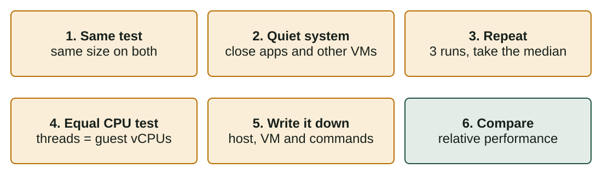
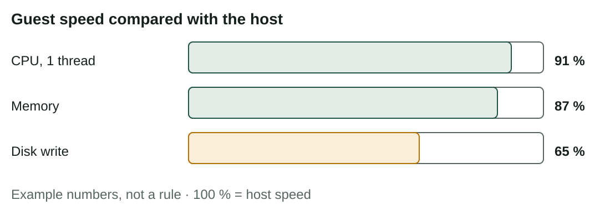

## What you will learn

:::pasos
- What to **expect** from a VM: **how much slower** is it?
- What makes a VM **slower or faster**
- A **method** to measure CPU, memory and disk on the host and the guest
- How to **read and explain** the results with numbers
:::

---

## "My VM is slow" is not a measurement

:::pasos
- A VM runs on the **same hardware** as the host: it cannot be faster
- The question is **how much slower**, and in which kind of work
- The numbers depend on your **processor, disk, programs and settings**
- That is why we **measure** instead of guessing
:::

---

## What do we expect?

| Resource | What happens in a VM | Typical difference |
|---|---|---|
| **CPU** | With VT-x or AMD-V, most instructions run directly | Very small; often 90 % or more |
| **Memory** | Nested paging (EPT/NPT) makes address translation fast | Small, if the host has enough |
| **Disk** | Every request goes through a virtual controller and the host file system | The biggest difference |
| **Network** | A virtual card and the host network | Small for normal use |

---

## What makes a VM slower or faster? (1/2)

| Factor | Effect | What to do |
|---|---|---|
| **Disk type** | An SSD closes most of the gap | Store the VM on an SSD |
| **Hardware virtualization** | Without it: much slower, or no start | Enable it in the UEFI/BIOS |
| **Too many vCPUs** | The VM waits for free cores | 1-2 vCPUs, never more than host cores |
| **Too little RAM in the guest** | The guest uses the disk as memory (*swap*) | Give it what it needs |
| **Too much RAM for the guest** | The host swaps and all VMs suffer | Leave 2-3 GB or more for the host |

---

## What makes a VM slower or faster? (2/2)

| Factor | Effect | What to do |
|---|---|---|
| **Long snapshot chains** | Each read may look through several layers | Few snapshots; delete old ones |
| **Disk allocation** | A dynamic disk must grow while writing | Fixed size for performance tests |
| **Other VMs and programs** | They compete for CPU, memory and disk | No heavy tasks while measuring |
| **Guest Additions** | Without them, graphics and mouse feel slow | Install them |
| **Controller** | SATA/AHCI is a good general choice | Keep the default |

---

## How to measure fairly



---

## Relative performance

> relative performance (%) = guest result ÷ host result × 100

:::pasos
- **More is better** (operations per second, MB/s): guest ÷ host × 100
- **Less is better** (seconds): **host time ÷ guest time** × 100
- Repeat each test **three times** and use the **median**
:::

---

## Know your system first (Linux)

```bash
lscpu                       # processor model, cores, virtualization
nproc                       # number of CPUs the system can use
free -h                     # total and free memory
lsblk -d -o NAME,SIZE,ROTA  # disks; ROTA 1 = mechanical, 0 = SSD
systemd-detect-virt         # inside a VM: the hypervisor ("oracle")
```

---

## Tests on Linux: CPU and memory

```bash
sudo apt install sysbench
sysbench cpu --cpu-max-prime=20000 --threads=1 run
sysbench memory --memory-block-size=1M --memory-total-size=10G run
```

:::pasos
- CPU: **events per second** (more is better) or **total time** (less is better)
- Repeat with `--threads=2`, or as many as the guest **vCPUs**
- Memory: **MiB transferred per second** (more is better)
:::

---

## Tests on Linux: disk writing with dd

```bash
dd if=/dev/zero of=./test.tmp bs=1M count=1024 oflag=direct status=progress
rm ./test.tmp
```

- Writes a **1 GB file** skipping the cache, deletes it and prints the speed in **MB/s**

:::caution[Be careful with the path]
Write the file where you have **permission** and free space, and delete it afterwards.
:::

---

## Random reads and writes

```bash
sysbench fileio --file-total-size=2G prepare
sysbench fileio --file-total-size=2G --file-test-mode=rndrw --time=30 run
sysbench fileio --file-total-size=2G cleanup
```

Same three steps on the host and in the guest: **prepare**, **run**, **cleanup**.

---

## No tools? Measure the time

```bash
time sha256sum bigfile.iso       # CPU and disk reading
time cp bigfile.iso copy.iso     # disk reading and writing
```

:::pasos
- `time` shows `real`, `user` and `sys`
- For the comparison use **`real`**: what you wait
:::

---

## Tests on Windows

:::pasos
- **7-Zip** benchmark: *Tools → Benchmark*, or `7z b`: CPU and memory
- Disk: time how long it takes to **copy a big file**
- Use the **same file** on the host and in the guest
:::

```powershell
Measure-Command { Copy-Item .\big.bin .\copy.bin }
```

---

## A result table: the guest compared with the host



---

## How to explain it

:::pasos
- **CPU**: close to native speed, thanks to **VT-x**
- **Memory**: a little lower
- **Disk**: the weakest; every write goes through the **virtual controller** and the host file system
- In this example, the guest disk was **dynamic**
:::

---

## Write the report

:::pasos
1. Describe the **system** and the **method**
2. Give the **table** with the results and the relative performance
3. Write a **conclusion**: the biggest difference, with one or two causes
4. Say what you would **change** to improve it, and why
:::

---

## It is not only about speed

:::note[It is not only about speed]
Even if the guest is **10-30 % slower** in some tests, the advantages (snapshots, isolation, fast creation) may be worth much more.

The aim is to **know the cost**, not to avoid virtualization.
:::

---

## Try it yourself

::laboratorio[Resource allocator]{src="virtualizacion" pestana="resources"}

---

## Summary

- A guest is **never faster** than the host: **measure** how much slower
- The **disk** usually shows the biggest difference
- A fair test: **same test, quiet system, 3 runs, median, notes**
- Relative performance = **guest ÷ host × 100**
- Explain the result with **causes**; speed is not the only criterion

[Activities of the unit →](/docencia/smr/som/ud02-virtualizacion/actividades/)

---

## Credits

These slides summarise the SOM course notes by Moisés Mas Rocamora, Daniel Álvarez Santamaría and Jana Taboada León, licensed under **CC BY-NC-SA 4.0**. They are shared under the same licence.
