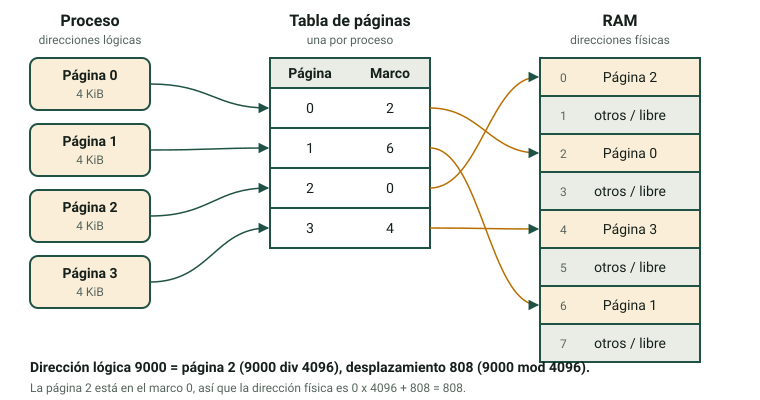

La RAM es rápida, pero limitada, y todo proceso en ejecución necesita un poco. El gestor de memoria del sistema operativo decide dónde va cada proceso, lo mantiene alejado de los demás y, cuando la RAM se llena, usa el disco para ganar espacio. En esta página aprenderás las técnicas que lo hacen posible y practicarás los cálculos.

:::tip[Cómo usar esta página]
1. Lee los apartados 1 a 6 (unos 60 minutos) y repite los cálculos en papel.
2. Haz la parte de memoria de la [actividad 5](/docencia/smr/som/ud03-funciones-sistema-operativo/actividades/es/) en tu propio ordenador.
3. El laboratorio de esta unidad no tiene una pestaña de memoria: la práctica son los cálculos. Usa una calculadora.
:::

## 1. Qué hace el gestor de memoria

El gestor de memoria tiene cinco tareas:

1. Saber qué partes de la RAM están **libres** y cuáles **en uso**.
2. **Asignar** memoria a cada proceso cuando empieza y recuperarla cuando termina.
3. **Proteger**: un proceso no debe leer ni escribir la memoria de otro proceso ni la del núcleo.
4. Permitir **compartir** cuando es útil, por ejemplo dos procesos que usan la misma biblioteca o que intercambian datos.
5. Mover datos entre la **RAM y el disco** cuando la RAM no basta.

Un proceso ve la memoria como un conjunto de **direcciones lógicas** (llamadas también *direcciones virtuales*), que empiezan en 0 para cada proceso. La posición real en la RAM es la **dirección física**. El hardware (la *MMU*, unidad de gestión de memoria) traduce una en otra cada vez que el proceso accede a la memoria. Esta traducción es la clave de la protección y de la flexibilidad: el SO puede colocar un proceso en cualquier lugar de la RAM, o incluso moverlo, y el programa no lo nota.

## 2. Asignación contigua y fragmentación

La idea más simple es dar a cada proceso **un bloque** de memoria continua. Hay dos formas de dividir la RAM.

- **Particiones fijas.** La RAM se divide de antemano en bloques del mismo tamaño o de tamaños distintos. Un proceso usa una partición. Es fácil de gestionar, pero el proceso casi nunca llena su partición.
- **Particiones variables.** Cada proceso recibe exactamente la memoria que pide.

Las dos pierden memoria. Este desperdicio es la **fragmentación**.

| | Fragmentación interna | Fragmentación externa |
|---|---|---|
| Dónde | **Dentro** de un bloque asignado | **Entre** bloques |
| Causa típica | Bloques o particiones de tamaño fijo | Bloques de tamaño variable que aparecen y desaparecen |
| Ejemplo | Un proceso de 50 KiB en una partición de 64 KiB desperdicia 14 KiB | Hay bloques libres de 30, 20 y 40 KiB que no son contiguos; un proceso de 60 KiB no cabe aunque haya 90 KiB libres |
| Solución | Bloques más pequeños | **Compactación**: mover los procesos juntos para unir los bloques libres (lento) |

La compactación obliga al SO a reubicar procesos mientras se ejecutan y cuesta mucho tiempo. Los sistemas modernos evitan el problema con la paginación.

## 3. Paginación

En la **paginación**, el SO divide:

- la memoria lógica del proceso en bloques de igual tamaño llamados **páginas**;
- la RAM física en bloques del mismo tamaño llamados **marcos** (*frames*, o marcos de página).

Cualquier página puede ir a cualquier marco libre, así que el proceso no necesita memoria continua. El SO mantiene una **tabla de páginas** para cada proceso, que dice en qué marco está cada página.



Una dirección lógica tiene dos partes: el **número de página** y el **desplazamiento** dentro de la página.

```text
número de página = dirección lógica  div  tamaño de página
desplazamiento   = dirección lógica  mod  tamaño de página
dirección física = número de marco × tamaño de página + desplazamiento
```

**Ejemplo.** Tamaño de página = 4 KiB = 4096 bytes. El proceso quiere leer la dirección lógica 9000.

1. Página = 9000 div 4096 = **2**. Desplazamiento = 9000 − 2 × 4096 = **808**.
2. La tabla de páginas dice que la página 2 está en el marco **0**.
3. Dirección física = 0 × 4096 + 808 = **808**.

Si la tabla de páginas dijera marco 5, la dirección física sería 5 × 4096 + 808 = 21288.

**Fragmentación en la paginación.** No hay fragmentación externa, porque todos los marcos tienen el mismo tamaño. Hay un poco de fragmentación interna, solo en la **última página** de cada proceso. Por ejemplo, un proceso de 18 KiB necesita ⌈18 / 4⌉ = 5 páginas (20 KiB) y desperdicia 2 KiB.

**Tamaño de página.** Las páginas pequeñas desperdician menos memoria, pero hacen más grande la tabla de páginas. Tamaño típico: 4 KiB.

## 4. Segmentación

En la **segmentación**, el proceso se divide en partes lógicas de **tamaño distinto** que tienen sentido para el programador: por ejemplo el código, los datos y la pila. Cada parte es un **segmento**. Cada segmento tiene una **base** (dónde empieza en la RAM) y un **límite** (su longitud). Una dirección lógica es un par **(segmento, desplazamiento)**.

**Ejemplo.** Tabla de segmentos de un proceso:

| Segmento | Contenido | Base | Límite |
|---|---|---|---|
| 0 | Código | 4000 | 1500 |
| 1 | Datos | 9000 | 800 |
| 2 | Pila | 20000 | 2000 |

- Dirección (1, 500): 500 < 800, así que es válida. Dirección física = 9000 + 500 = **9500**.
- Dirección (1, 900): 900 ≥ 800, así que el desplazamiento está fuera del segmento. El hardware lanza un error y el SO finaliza el proceso. En Linux verás **Segmentation fault**.

La segmentación protege bien y facilita compartir (dos procesos pueden compartir el segmento de código). Pero, como los segmentos tienen tamaños distintos, sufre **fragmentación externa**. Algunos sistemas combinan las dos técnicas: dividen cada segmento en páginas.

| | Paginación | Segmentación |
|---|---|---|
| Tamaño de bloque | Fijo (páginas y marcos) | Variable (segmentos) |
| Visible para el programador | No | Sí (código, datos, pila) |
| Dirección | página + desplazamiento | segmento + desplazamiento |
| Fragmentación | Interna, pequeña | Externa |

## 5. Memoria virtual

¿Y si los programas necesitan más memoria que la RAM que tiene el ordenador? El SO usa una parte del disco como ampliación de la RAM. Es la **memoria virtual**. El área del disco se llama:

- **partición swap** o archivo swap en Linux;
- **archivo de paginación** (`C:\pagefile.sys`) en Windows.

Funciona con paginación. No todas las páginas de un proceso se necesitan a la vez, así que el SO carga una página en la RAM **solo cuando el proceso la necesita**. Es la *paginación por demanda*. Cuando el proceso usa una página que no está en la RAM, ocurre un **fallo de página**:

1. La CPU lanza un fallo de página y el proceso se bloquea (estado **Bloqueado**).
2. El SO busca un marco libre. Si no hay ninguno, elige una página para retirarla (véase más abajo). Si la página retirada se había modificado, se escribe en el área de swap.
3. El SO lee la página necesaria del disco al marco y actualiza la tabla de páginas.
4. El proceso pasa a **Listo** y repite la instrucción que falló.

Los fallos de página son muy lentos comparados con la RAM, porque el disco es miles de veces más lento. Si el sistema tiene muy poca RAM, pasa la mayor parte del tiempo moviendo páginas y el ordenador se vuelve casi inutilizable. Es la **hiperpaginación** (*thrashing*). La luz del disco está siempre encendida y los programas reaccionan muy despacio.

### Algoritmos de reemplazo de páginas

Cuando la RAM está llena, el SO debe elegir una página **víctima** para retirarla. Dos algoritmos clásicos:

- **FIFO**: retira la página que lleva más tiempo en memoria. Es simple, pero la página más antigua puede ser una que usas todo el rato.
- **LRU** (Least Recently Used, la menos usada recientemente): retira la página que lleva más tiempo sin usarse. Se basa en la idea de que el uso pasado predice el futuro. Da menos fallos pero es más costoso de implementar; los sistemas reales usan aproximaciones.

**Ejemplo.** El proceso usa estas páginas en este orden (la *cadena de referencias*): `3 2 3 5 4 3 5 5 1 5 2 1`. Tiene **3 marcos**. F significa fallo de página.

| Ref | FIFO: páginas en memoria (la más antigua primero) | FIFO | LRU: páginas en memoria (la menos usada recientemente primero) | LRU |
|---|---|---|---|---|
| 3 | 3 | F | 3 | F |
| 2 | 3, 2 | F | 3, 2 | F |
| 3 | 3, 2 | | 2, 3 | |
| 5 | 3, 2, 5 | F | 2, 3, 5 | F |
| 4 | 2, 5, 4 | F | 3, 5, 4 | F |
| 3 | 5, 4, 3 | F | 5, 4, 3 | |
| 5 | 5, 4, 3 | | 4, 3, 5 | |
| 5 | 5, 4, 3 | | 4, 3, 5 | |
| 1 | 4, 3, 1 | F | 3, 5, 1 | F |
| 5 | 3, 1, 5 | F | 3, 1, 5 | |
| 2 | 1, 5, 2 | F | 1, 5, 2 | F |
| 1 | 1, 5, 2 | | 5, 2, 1 | |
| **Fallos** | | **8** | | **6** |

:::note[¿Más memoria ayuda siempre?]
Con FIFO no. Con la cadena `1 2 3 4 1 2 5 1 2 3 4 5`, FIFO da 9 fallos con 3 marcos y 10 fallos con 4 marcos. Es la **anomalía de Belady**. LRU nunca tiene este problema.
:::

## 6. Comprobar y optimizar la memoria

Para **optimizar** la memoria primero mides y después actúas.

### Medir

| Herramienta | Sistema | Qué mirar |
|---|---|---|
| `free -h` | Linux | La columna **available** (disponible): memoria que pueden usar los programas. Un valor *free* bajo es normal, porque Linux usa la RAM libre como caché de disco. |
| `top` (tecla `M`) | Linux | `RES` por proceso; la línea `MiB Swap` |
| `vmstat 1` | Linux | Columnas `si` y `so`: si no son cero todo el tiempo, el sistema está intercambiando |
| `swapon --show` | Linux | Qué áreas de swap existen y cuánto se han llenado |
| Administrador de tareas → Rendimiento → Memoria | Windows | En uso, Disponible, Confirmada, En caché |
| Administrador de tareas → Procesos (ordenar por Memoria) | Windows | Qué programas usan más RAM |
| Monitor de recursos (`resmon`) | Windows | Pestaña *Memoria*, *Errores de página físicos/s* |

### Actuar

- **Cierra o reinicia** los programas que usan demasiada memoria. Los navegadores con muchas pestañas son la causa habitual.
- **Reduce los programas de inicio**: Administrador de tareas → *Aplicaciones de inicio* en Windows. Menos programas al arrancar significa más RAM libre.
- **Usa software más ligero** en ordenadores antiguos (por ejemplo, un entorno de escritorio ligero en Linux).
- **Añade RAM** si ves intercambio constante. Es la solución real a la hiperpaginación.
- **Mantén activada la memoria virtual.** En Windows, deja que el sistema gestione el archivo de paginación. En Linux, un área de swap también sirve para hibernar y para sacar de la RAM las páginas que se usan poco.
- Un sistema de 32 bits solo puede direccionar 4 GiB; para usar más RAM hace falta un sistema de 64 bits.

:::caution[El swap no sustituye a la RAM]
El disco es mucho más lento que la RAM, incluso un SSD. El swap salva al sistema de un fallo cuando la RAM se llena, pero no hará que el ordenador sea rápido. Si necesitas intercambiar todo el tiempo, necesitas más RAM.
:::

## Comprueba lo aprendido

1. Un sistema usa particiones fijas de 100 KiB. Se carga un proceso de 72 KiB. ¿Qué tipo de fragmentación aparece y cuánta memoria se desperdicia?

   <details>
   <summary>Respuesta</summary>

   Fragmentación **interna**, porque el desperdicio está dentro del bloque asignado. 100 − 72 = **28 KiB**.

   </details>

2. El tamaño de página es 2 KiB (2048 bytes). La página 3 del proceso está en el marco 7. ¿Cuál es la dirección física de la dirección lógica 6700?

   <details>
   <summary>Respuesta</summary>

   Página = 6700 div 2048 = 3. Desplazamiento = 6700 − 3 × 2048 = 556. Marco 7, así que dirección física = 7 × 2048 + 556 = 14336 + 556 = **14892**.

   </details>

3. ¿Qué ocurre si un proceso intenta usar el desplazamiento 1200 en un segmento con límite 1000?

   <details>
   <summary>Respuesta</summary>

   El desplazamiento supera el límite, así que el hardware lanza una excepción y el SO finaliza el proceso (un *fallo de segmentación* en Linux).

   </details>

4. Explica qué es un fallo de página y qué estado de proceso se usa mientras se lee la página del disco.

   <details>
   <summary>Respuesta</summary>

   Es un acceso a una página que no está en la RAM. El SO debe leerla del disco (o del swap). El proceso permanece en el estado **Bloqueado** durante la lectura y después pasa a **Listo**.

   </details>

5. `vmstat 1` muestra números grandes en `si` y `so` todo el tiempo y la luz del disco está siempre encendida. ¿Qué está pasando y qué recomiendas?

   <details>
   <summary>Respuesta</summary>

   El sistema está intercambiando constantemente: hiperpaginación. Cierra los programas que consumen mucha memoria y, si la situación es normal para tu uso, añade más RAM.

   </details>

## Glosario

| English | Castellano |
|---|---|
| memory manager | gestor de memoria |
| logical (virtual) address | dirección lógica (virtual) |
| physical address | dirección física |
| fragmentation (internal / external) | fragmentación (interna / externa) |
| compaction | compactación |
| paging | paginación |
| page / frame | página / marco |
| page table | tabla de páginas |
| offset | desplazamiento |
| segmentation | segmentación |
| base / limit | base / límite |
| segmentation fault | fallo de segmentación |
| virtual memory | memoria virtual |
| swap / page file | área de intercambio (swap) / archivo de paginación |
| page fault | fallo de página |
| thrashing | hiperpaginación (thrashing) |
| page replacement | reemplazo de páginas |
| reference string | cadena de referencias |

:::note[Créditos]
Esta página adapta los apuntes del curso de SOM de Moisés Mas Rocamora, Daniel Álvarez Santamaría y Jana Taboada León, con licencia CC BY-NC-SA 4.0. Esta página se comparte con la misma licencia.
:::
