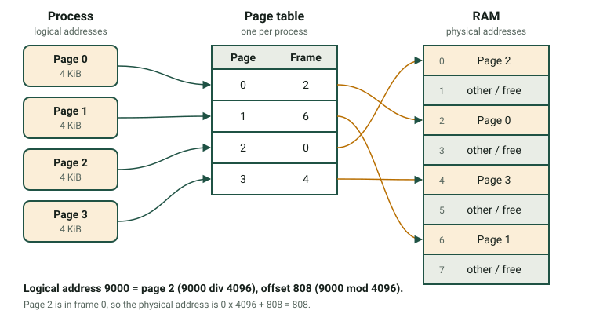

RAM is fast, but it is limited and every running process needs some. The memory manager of the operating system decides where each process goes, keeps it away from the others and, when RAM is full, uses the disk to gain more space. In this page you will learn the techniques that make this possible and you will practise the calculations.

:::tip[How to use this page]
1. Read sections 1 to 6 (about 60 minutes) and repeat the calculations on paper.
2. Do the memory part of [Activity 5](/docencia/smr/som/ud03-funciones-sistema-operativo/actividades/) on your own computer.
3. This unit's lab does not have a memory tab: the calculations are the practice. Use a calculator.
:::

## 1. What the memory manager does

The memory manager has five jobs:

1. Know which parts of RAM are **free** and which are **used**.
2. **Assign** memory to each process when it starts and take it back when it ends.
3. **Protect**: a process must not read or write the memory of another process or of the kernel.
4. Allow **sharing** when it is useful, for example two processes that use the same library or that exchange data.
5. Move data between **RAM and disk** when RAM is not enough.

A process sees memory as a set of **logical addresses** (also called *virtual addresses*), which start at 0 for every process. The real position in RAM is the **physical address**. The hardware (the *MMU*, memory management unit) translates one into the other every time the process accesses memory. This translation is the key to protection and to flexibility: the OS can put a process anywhere in RAM, or even move it, and the program does not notice.

## 2. Contiguous allocation and fragmentation

The simplest idea is to give each process **one block** of continuous memory. There are two ways to divide RAM.

- **Fixed partitions.** RAM is divided in advance into blocks of the same or of different sizes. A process uses one partition. Easy to manage, but the process rarely fills its partition.
- **Variable partitions.** Each process receives exactly the memory it asks for.

Both lose memory. This waste is **fragmentation**.

| | Internal fragmentation | External fragmentation |
|---|---|---|
| Where | **Inside** an assigned block | **Between** blocks |
| Typical cause | Fixed-size blocks or partitions | Variable-size blocks that appear and disappear |
| Example | A 50 KiB process in a 64 KiB partition wastes 14 KiB | Free blocks of 30, 20 and 40 KiB are not adjacent; a 60 KiB process does not fit although 90 KiB are free |
| Solution | Smaller blocks | **Compaction**: move the processes together to join the free blocks (slow) |

Compaction needs the OS to relocate processes while they run, and it costs a lot of time. Modern systems avoid the problem with paging.

## 3. Paging

In **paging**, the OS divides:

- the logical memory of the process into blocks of equal size called **pages**;
- the physical RAM into blocks of the same size called **frames** (also *page frames*).

Any page can go into any free frame, so the process does not need continuous memory. The OS keeps a **page table** for each process, which says in which frame each page is.



A logical address has two parts: the **page number** and the **offset** inside the page.

```text
page number = logical address  div  page size
offset      = logical address  mod  page size
physical address = frame number × page size + offset
```

**Example.** Page size = 4 KiB = 4096 bytes. The process wants to read the logical address 9000.

1. Page = 9000 div 4096 = **2**. Offset = 9000 − 2 × 4096 = **808**.
2. The page table says that page 2 is in frame **0**.
3. Physical address = 0 × 4096 + 808 = **808**.

If the page table said frame 5, the physical address would be 5 × 4096 + 808 = 21288.

**Fragmentation in paging.** There is no external fragmentation, because every frame is the same size. There is a little internal fragmentation, only in the **last page** of each process. For example, a process of 18 KiB needs ⌈18 / 4⌉ = 5 pages (20 KiB) and wastes 2 KiB.

**Page size.** Small pages waste less memory but make the page table bigger. Typical size: 4 KiB.

## 4. Segmentation

In **segmentation**, the process is divided into logical parts of **different size** that make sense for the programmer: for example the code, the data and the stack. Each part is a **segment**. Every segment has a **base** (where it starts in RAM) and a **limit** (its length). A logical address is a pair **(segment, offset)**.

**Example.** Segment table of a process:

| Segment | Content | Base | Limit |
|---|---|---|---|
| 0 | Code | 4000 | 1500 |
| 1 | Data | 9000 | 800 |
| 2 | Stack | 20000 | 2000 |

- Address (1, 500): 500 < 800, so it is valid. Physical address = 9000 + 500 = **9500**.
- Address (1, 900): 900 ≥ 800, so the offset is outside the segment. The hardware raises an error and the OS ends the process. In Linux you see **Segmentation fault**.

Segmentation protects well and makes sharing easy (two processes can share the code segment). But, as segments have different sizes, it suffers from **external fragmentation**. Some systems combine both techniques: they divide each segment into pages.

| | Paging | Segmentation |
|---|---|---|
| Block size | Fixed (pages and frames) | Variable (segments) |
| Visible to the programmer | No | Yes (code, data, stack) |
| Address | page + offset | segment + offset |
| Fragmentation | Internal, small | External |

## 5. Virtual memory

What if the programs need more memory than the RAM that the computer has? The OS uses part of the disk as an extension of RAM. This is **virtual memory**. The disk area is called:

- **swap partition** or swap file in Linux;
- **page file** (`C:\pagefile.sys`) in Windows.

It works with paging. Not all the pages of a process are needed at the same time, so the OS loads a page into RAM **only when the process needs it**. This is *demand paging*. When the process uses a page that is not in RAM, a **page fault** happens:

1. The CPU raises a page fault and the process is blocked (state **Waiting**).
2. The OS looks for a free frame. If there is none, it chooses a page to remove (see below). If the removed page was modified, it is written to the swap area.
3. The OS reads the needed page from the disk into the frame and updates the page table.
4. The process goes to **Ready** and repeats the instruction that failed.

Page faults are very slow compared with RAM, because the disk is thousands of times slower. If the system has too little RAM, it spends most of the time moving pages and the computer becomes almost unusable. This is **thrashing**. The disk light is on all the time and the programs react very slowly.

### Page replacement algorithms

When RAM is full, the OS must choose a **victim** page to remove. Two classic algorithms:

- **FIFO**: remove the page that has been in memory the longest. Simple, but the oldest page may be one that you use all the time.
- **LRU** (Least Recently Used): remove the page that has not been used for the longest time. It uses the idea that the past use predicts the future. It gives fewer faults but is more costly to implement; real systems use approximations.

**Example.** The process uses these pages in this order (the *reference string*): `3 2 3 5 4 3 5 5 1 5 2 1`. It has **3 frames**. F means page fault.

| Ref | FIFO: pages in memory (oldest first) | FIFO | LRU: pages in memory (least recently used first) | LRU |
|---|---|---|---|---|
| 3 | 3 | F | 3 | F |
| 2 | 3, 2 | F | 3, 2 | F |
| 3 | 3, 2 | | 2, 3 | |
| 5 | 3, 2, 5 | F | 2, 3, 5 | F |
| 4 | 2, 5, 4 | F | 3, 5, 4 | F |
| 3 | 5, 4, 3 | F | 5, 4, 3 | |
| 5 | 5, 4, 3 | | 4, 3, 5 | |
| 5 | 5, 4, 3 | | 4, 3, 5 | |
| 1 | 4, 3, 1 | F | 3, 5, 1 | F |
| 5 | 3, 1, 5 | F | 3, 1, 5 | |
| 2 | 1, 5, 2 | F | 1, 5, 2 | F |
| 1 | 1, 5, 2 | | 5, 2, 1 | |
| **Faults** | | **8** | | **6** |

:::note[Does more memory always help?]
Not with FIFO. With the string `1 2 3 4 1 2 5 1 2 3 4 5`, FIFO gives 9 faults with 3 frames and 10 faults with 4 frames. This is **Belady's anomaly**. LRU never has this problem.
:::

## 6. Checking and optimising memory

To **optimise** memory you first measure, then you act.

### Measure

| Tool | System | What to look at |
|---|---|---|
| `free -h` | Linux | The column **available**: memory that programs can use. A low *free* value is normal, because Linux uses free RAM as disk cache. |
| `top` (key `M`) | Linux | `RES` per process; the line `MiB Swap` |
| `vmstat 1` | Linux | Columns `si` and `so`: if they are not zero all the time, the system is swapping |
| `swapon --show` | Linux | Which swap areas exist and how full they are |
| Task Manager → Performance → Memory | Windows | In use, Available, Committed, Cached |
| Task Manager → Processes (sort by Memory) | Windows | Which programs use the most RAM |
| Resource Monitor (`resmon`) | Windows | *Memory* tab, *Hard Faults/sec* |

### Act

- **Close or restart** the programs that use too much memory. Browsers with many tabs are the usual cause.
- **Reduce startup programs**: Task Manager → *Startup apps* in Windows. Fewer programs at boot means more free RAM.
- **Use lighter software** on old computers (for example a light desktop environment in Linux).
- **Add RAM** if you see constant swapping. This is the real solution to thrashing.
- **Keep virtual memory enabled.** In Windows, let the system manage the page file. In Linux, a swap area is also useful to hibernate and to move rarely used pages out of RAM.
- A 32-bit system can address only 4 GiB; a 64-bit system is needed to use more RAM.

:::caution[Swap is not a replacement for RAM]
Disk is much slower than RAM, even an SSD. Swap saves the system from a crash when RAM is full, but it will not make the computer fast. If you need to swap all the time, you need more RAM.
:::

## Comprueba lo aprendido

1. A system uses fixed partitions of 100 KiB. A process of 72 KiB is loaded. What type of fragmentation appears and how much memory is wasted?

   <details>
   <summary>Answer</summary>

   **Internal** fragmentation, because the waste is inside the assigned block. 100 − 72 = **28 KiB**.

   </details>

2. Page size is 2 KiB (2048 bytes). Page 3 of the process is in frame 7. What is the physical address of the logical address 6700?

   <details>
   <summary>Answer</summary>

   Page = 6700 div 2048 = 3. Offset = 6700 − 3 × 2048 = 556. Frame 7, so physical address = 7 × 2048 + 556 = 14336 + 556 = **14892**.

   </details>

3. What happens if a process tries to use the offset 1200 in a segment with limit 1000?

   <details>
   <summary>Answer</summary>

   The offset is beyond the limit, so the hardware raises an exception, and the OS ends the process (a *segmentation fault* in Linux).

   </details>

4. Explain what a page fault is and which process state is used while the page is read from disk.

   <details>
   <summary>Answer</summary>

   It is an access to a page that is not in RAM. The OS must read it from the disk (or from swap). The process stays in the **Waiting** state during the read and then goes to **Ready**.

   </details>

5. `vmstat 1` shows large numbers in `si` and `so` all the time and the disk light is always on. What is happening and what do you recommend?

   <details>
   <summary>Answer</summary>

   The system is swapping constantly: thrashing. Close memory-hungry programs and, if the situation is normal for your use, add more RAM.

   </details>

## Glossary

| English | Castellano |
|---|---|
| memory manager | gestor de memoria |
| logical (virtual) address | dirección lógica (virtual) |
| physical address | dirección física |
| fragmentation (internal / external) | fragmentación (interna / externa) |
| compaction | compactación |
| paging | paginación |
| page / frame | página / marco |
| page table | tabla de páginas |
| offset | desplazamiento |
| segmentation | segmentación |
| base / limit | base / límite |
| segmentation fault | fallo de segmentación |
| virtual memory | memoria virtual |
| swap / page file | área de intercambio (swap) / archivo de paginación |
| page fault | fallo de página |
| thrashing | hiperpaginación (thrashing) |
| page replacement | reemplazo de páginas |
| reference string | cadena de referencias |

:::note[Credits]
This page adapts the SOM course notes by Moisés Mas Rocamora, Daniel Álvarez Santamaría and Jana Taboada León, licensed under CC BY-NC-SA 4.0. This page is shared under the same licence.
:::
