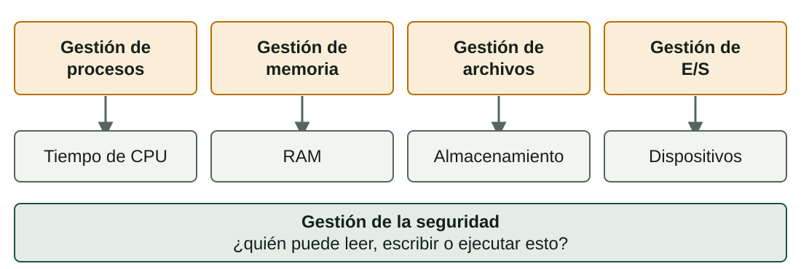
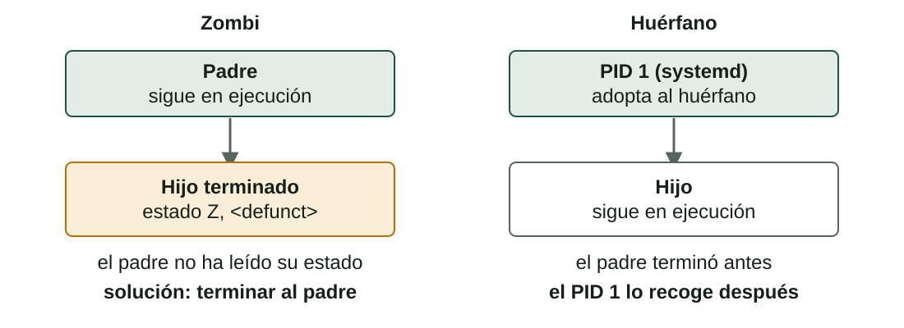

## Qué aprenderás

:::pasos
- Las **funciones** de un sistema operativo
- **Programa** frente a **proceso**, y el **PCB**
- **Procesos de usuario**, **procesos del sistema** y **servicios**
- Cómo **ver y controlar** procesos en Linux y Windows
- Los **estados** de un proceso, las **señales**, los **zombis** y los **huérfanos**
:::

---

## El SO gestiona los recursos del ordenador



---

## Otras tareas del SO

:::pasos
- **Contabilidad**: cuánta CPU y memoria usó cada usuario o programa
- **Detección de errores**: mensajes escritos en **registros** (*logs*)
- **Interfaz de usuario**: gráfica o de línea de órdenes
:::

---

## ¿Programa o proceso?

:::pasos
- Un **programa**: un archivo en disco con instrucciones; **no hace nada solo**
- Un **proceso**: un programa que se está **ejecutando**, cargado en memoria y con tiempo de CPU
- Un programa puede crear **varios procesos**
- Tres ventanas del navegador: **tres procesos**, cada uno con sus datos
:::

---

## Qué da el SO a un proceso nuevo

:::pasos
- Un **PID**: un número único
- Un **área de memoria** donde otros procesos no pueden escribir
- Recursos: **archivos abiertos** y conexiones de red
- Toda la información va en el **PCB** (bloque de control de proceso)
:::

---

## Memoria del proceso y su PCB


---

## Dónde ver los campos del PCB

| Campo del PCB | Dónde se ve |
|---|---|
| **PID** | `ps`, `top`, Administrador de tareas |
| **PPID** (padre) | `ps -ef` |
| **Estado** | Columna `STAT` de `ps` |
| **Prioridad** | `PR` y `NI` en `top` |
| **Memoria** | `%MEM`, `RSS`, `VSZ` |

---

## Todo proceso tiene un padre

:::pasos
- Un proceso nuevo lo crea **siempre otro**
- En un terminal, el **intérprete** (*shell*) crea un hijo por cada orden
- En lo alto del árbol: **`systemd`** (PID 1) en casi todo Linux
- En Windows: **`System`** o **`smss.exe`**
- Lo inicia el propio SO en el **arranque**
:::

---

## ¿Quién inicia un proceso?

:::pasos
- **Procesos de usuario**: los inicia una persona (navegador, editor, terminal), con **los derechos de ese usuario**
- **Procesos del sistema**: los inicia el SO, casi todos en el **arranque**, con privilegios altos
- Un **servicio** (en Linux, **demonio**) se ejecuta en **segundo plano**, sin ventana, y espera trabajo
- Ejemplos: servidor web, cola de impresión, cortafuegos; en Linux suelen acabar en `d`: `sshd`
:::

---

## Servicios en Linux y Windows

| | Linux | Windows |
|---|---|---|
| Primer proceso | `systemd` (PID 1) | `System`, `smss.exe` |
| Gestor de servicios | `systemd` | `services.exe` |
| Listar servicios | `systemctl list-units --type=service` | `services.msc` |
| Iniciar / detener | `sudo systemctl start\|stop nombre` | `net start\|stop nombre` |
| Iniciar con el sistema | `sudo systemctl enable nombre` | Tipo de inicio **Automático** |

---

## Tipos de inicio en Windows

:::pasos
- **Automático**: arranca con el sistema (o poco después: *inicio retrasado*)
- **Manual**: arranca solo cuando un programa o servicio lo pide
- **Deshabilitado**: no puede arrancar
- Un `svchost.exe` suele alojar **varios servicios**
:::

---

## No detengas servicios que no conoces

:::caution[No detengas servicios que no conoces]
Detener un servicio puede estropear **la red, el sonido o las actualizaciones**.

En clase, practica solo con los servicios que indique tu profesor y **anota el estado original** antes de cambiar nada.
:::

---

## Linux: ps aux

```text
USER      PID %CPU %MEM STAT COMMAND
root        1  0.0  0.1 Ss   /sbin/init
student  2310  0.3  2.1 Sl   firefox
student  4021  0.0  0.1 Ss   bash
student  4388  0.0  0.0 R+   ps aux
```

Lista **todos** los procesos. Tus números serán distintos.

---

## Leer las columnas de ps

:::pasos
- `USER` y `PID`: el propietario y el identificador
- `%CPU` y `%MEM`: parte de CPU y RAM que usa
- `VSZ` y `RSS`: memoria virtual y real (KiB)
- `TTY`: `?` significa sin terminal: típico de los **servicios**
- `STAT`: el estado del proceso
- `COMMAND`: los nombres entre `[corchetes]` son **hilos del núcleo**
:::

---

## Linux: top lo muestra en vivo

| Tecla | Qué hace |
|---|---|
| `P` | Ordena por CPU |
| `M` | Ordena por memoria |
| `k` | Mata un proceso |
| `r` | Cambia su prioridad |
| `q` | Sale |

`htop` es una versión más amable, no siempre instalada.

---

## Linux: servicios con systemctl

```bash
systemctl status cron
systemctl list-units --type=service --state=running
```

---

## Windows: Administrador de tareas

Ábrelo con `Ctrl + Mayús + Esc`.

| Pestaña | Qué ves |
|---|---|
| **Procesos** | Aplicaciones y procesos en segundo plano, con CPU, memoria, disco y red |
| **Detalles** | PID, estado, usuario; *Finalizar tarea*, *Establecer prioridad* |
| **Servicios** | Servicios con PID y estado |
| **Rendimiento** | Gráficas de CPU, memoria, disco y red |

---

## Windows: más herramientas

:::pasos
- **`services.msc`** (`Win + R`): descripción, estado, tipo de inicio, cuenta
- **`tasklist`**: lista los procesos desde la línea de órdenes
- **`taskkill /PID 1234`**: finaliza uno
:::

---

## Un proceso cambia entre estados


---

## Los cinco estados

| Estado | Significado |
|---|---|
| **Nuevo** | El SO está creando el proceso |
| **Listo** | Lo tiene todo y espera una CPU libre |
| **En ejecución** | La CPU ejecuta sus instrucciones |
| **Bloqueado** | Parado hasta que ocurra algo (una lectura de disco) |
| **Terminado** | Ha acabado; el SO libera sus recursos |

---

## Las seis transiciones

:::pasos
1. **Nuevo → Listo** (admitir)
2. **Listo → En ejecución** (despachar): lo elige el planificador
3. **En ejecución → Listo** (fin de tiempo): **expulsión**
4. **En ejecución → Bloqueado**: pide E/S o un evento
5. **Bloqueado → Listo**: nunca directo a En ejecución
6. **En ejecución → Terminado** (salir)
:::

---

## El cambio de contexto

:::pasos
- El SO **guarda** los registros y el contador de programa del proceso saliente en su PCB
- **Carga** los del nuevo
- Mientras tanto, nadie hace trabajo útil
- Por eso debe ser **rápido** y **poco frecuente**
:::

---

## Estados en Linux: la columna STAT

| Código | Estado | Equivale a |
|---|---|---|
| `R` | En ejecución o listo para ejecutarse | En ejecución / Listo |
| `S` | Dormido, espera un evento | Bloqueado |
| `D` | Dormido, no se puede interrumpir | Bloqueado (disco) |
| `T` | Detenido (`Ctrl+Z` o una señal) | Suspendido |
| `Z` | Zombi | Terminado, sin recoger |

---

## Más símbolos tras la primera letra

:::pasos
- `s`: líder de sesión · `+`: proceso en primer plano · `l`: muchos hilos
- `<`: prioridad alta · `N`: prioridad baja
- `Ss` es un **líder de sesión dormido**: un intérprete esperando que escribas
- En **Detalles** de Windows: *En ejecución*, *Suspendido*, *No responde*
:::

---

## Primer plano y segundo plano

```bash
sleep 120 &        # iniciar en segundo plano
jobs               # listar los trabajos de este terminal
fg %1              # traer el trabajo 1 a primer plano
# pulsa Ctrl+Z     # detener (suspender) el trabajo en primer plano
bg %1              # continuarlo en segundo plano
kill %1            # terminar el trabajo 1
```

---

## Teclas en el terminal

:::pasos
- **`&`** al final: la orden se ejecuta en **segundo plano**
- **`Ctrl+C`**: pide al proceso en primer plano que **termine**
- **`Ctrl+Z`**: lo **detiene**
:::

---

## Señales: kill no siempre mata

| Orden | Señal | Qué ocurre |
|---|---|---|
| `kill PID` | `SIGTERM` (15) | Petición amable; puede guardar su trabajo |
| `kill -9 PID` | `SIGKILL` (9) | Termina al instante; úsala **la última** |
| `kill -STOP PID` | `SIGSTOP` (19) | Lo detiene (estado `T`) |
| `kill -CONT PID` | `SIGCONT` (18) | Continúa un proceso detenido |

Solo puedes enviar señales a **tus** procesos, salvo con `sudo`.

---

## Prioridad: el valor nice

```bash
nice -n 10 ./long-task.sh       # iniciar con prioridad baja
renice -n 5 -p 4021             # cambiar un proceso en marcha
```

:::pasos
- Nice va de **−20** (prioridad alta) a **19** (baja)
- Los usuarios normales solo pueden hacer sus procesos **«más amables»**
- Windows: *Establecer prioridad* en **Detalles**; no uses *Tiempo real*
:::

---

## Zombis

:::pasos
- Un hijo termina; el núcleo guarda su **PID y su estado de salida**
- Hasta que el padre lo lee con **`wait`**
- Hijo terminado y no leído: un **zombi**
- `Z` en `STAT`, `<defunct>` en `COMMAND`
- No usa CPU ni casi memoria, pero **ocupa un PID**
:::

---

## Zombi y huérfano



---

## Crear un zombi sin riesgo

```bash
bash -c 'sleep 2 & exec sleep 300' &
sleep 5
ps -eo pid,ppid,stat,cmd | grep -E 'sleep|defunct'
```

:::pasos
- `kill -9` al zombi: **no pasa nada**; ya está muerto
- `kill` a su **padre**: `systemd` lo adopta y lo elimina
- Unos pocos zombis son normales; **muchos que no se van** indican un fallo del padre
:::

---

## Pruébalo (1/3)

::laboratorio[Inspector de procesos]{src="planificador-de-procesos" pestana="inspector"}

---

## Pruébalo (2/3)

::laboratorio[Máquina de estados]{src="planificador-de-procesos" pestana="states"}

---

## Pruébalo (3/3)

::laboratorio[Terminal]{src="planificador-de-procesos" pestana="terminal"}

---

## Resumen

- El SO gestiona **CPU, memoria, almacenamiento y dispositivos**, y los protege
- Un **proceso** es un programa en ejecución, con un **PID** y un **PCB**
- Los **servicios** corren en segundo plano; `ps`, `top` y el Administrador de tareas los muestran
- Estados: **nuevo, listo, en ejecución, bloqueado, terminado**
- `kill` envía **señales**; un **zombi** es un hijo terminado que nadie recogió

[Actividades de la unidad →](/docencia/smr/som/ud03-funciones-sistema-operativo/actividades/es/)

---

## Créditos

Estas diapositivas resumen los apuntes del curso de SOM de Moisés Mas Rocamora, Daniel Álvarez Santamaría y Jana Taboada León, con licencia **CC BY-NC-SA 4.0**. Se comparten con la misma licencia.
