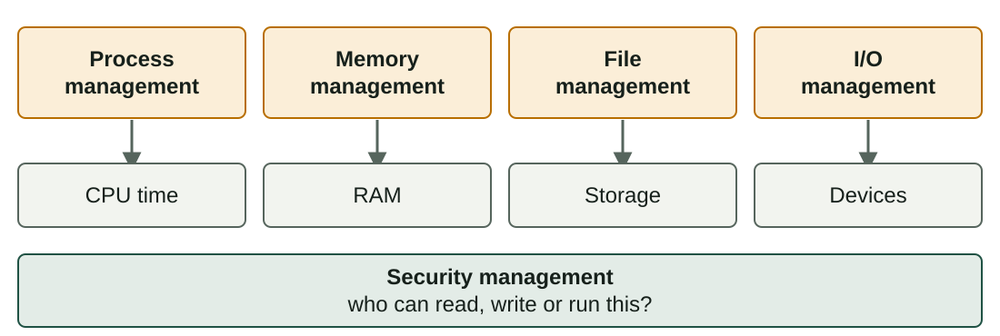
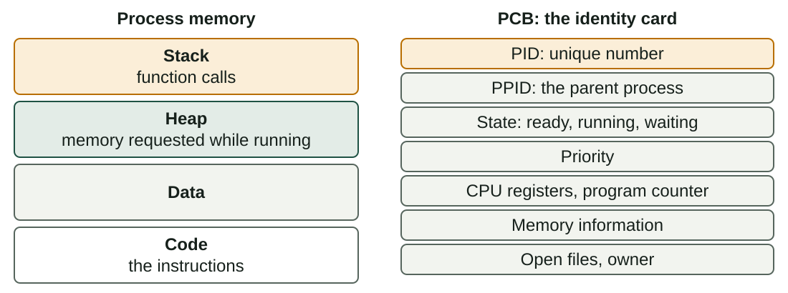
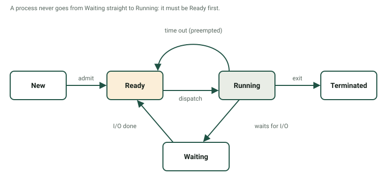
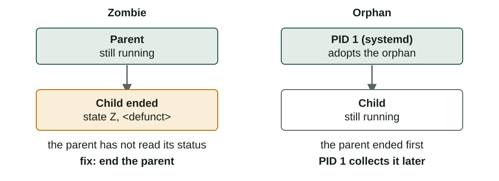

## What you will learn

:::pasos
- The **functions** of an operating system
- **Program** versus **process**, and the **PCB**
- **User processes**, **system processes** and **services**
- How to **see and control** processes in Linux and Windows
- The **states** of a process, **signals**, **zombies** and **orphans**
:::

---

## The OS manages the resources of the computer



---

## Other jobs of the OS

:::pasos
- **Accounting**: how much CPU and memory each user or program used
- **Error detection**: messages written in **logs**
- **User interface**: graphical or command line
:::

---

## Program or process?

:::pasos
- A **program**: a file on disk with instructions; it does **nothing by itself**
- A **process**: a program that is **running**, loaded in memory with CPU time
- One program can create **several processes**
- Three browser windows: **three processes**, each with its own data
:::

---

## What the OS gives a new process

:::pasos
- A **PID**: a unique number
- A **memory area** that other processes cannot write to
- Resources: **open files** and network connections
- All the information goes in the **PCB** (Process Control Block)
:::

---

## Process memory and its PCB



---

## Where to see the PCB fields

| PCB field | Where you can see it |
|---|---|
| **PID** | `ps`, `top`, Task Manager |
| **PPID** (parent) | `ps -ef` |
| **State** | `STAT` column of `ps` |
| **Priority** | `PR` and `NI` in `top` |
| **Memory** | `%MEM`, `RSS`, `VSZ` |

---

## Every process has a parent

:::pasos
- A new process is **always created by another one**
- In a terminal, the **shell** creates a child for each command
- Top of the tree: **`systemd`** (PID 1) in most Linux systems
- In Windows: **`System`** or **`smss.exe`**
- The OS itself starts it at **boot**
:::

---

## Who starts a process?

:::pasos
- **User processes**: started by a person (browser, editor, terminal), with **that user's rights**
- **System processes**: started by the OS, most at **boot**, with high privileges
- A **service** (Linux: **daemon**) runs in the **background**, with no window, and waits for work
- Examples: web server, print spooler, firewall; Linux names often end in `d`: `sshd`
:::

---

## Services in Linux and Windows

| | Linux | Windows |
|---|---|---|
| First process | `systemd` (PID 1) | `System`, `smss.exe` |
| Service manager | `systemd` | `services.exe` |
| List services | `systemctl list-units --type=service` | `services.msc` |
| Start / stop | `sudo systemctl start\|stop name` | `net start\|stop name` |
| Start at boot | `sudo systemctl enable name` | Startup type **Automatic** |

---

## Windows startup types

:::pasos
- **Automatic**: starts at boot (or soon after: *Delayed Start*)
- **Manual**: starts only when a program or service asks for it
- **Disabled**: it cannot start at all
- One `svchost.exe` often hosts **several services**
:::

---

## Do not stop services you do not know

:::caution[Do not stop services you do not know]
Stopping a service can break the **network, the sound or the updates**.

In class, practise only with the services your teacher names, and **write down the original state** before you change anything.
:::

---

## Linux: ps aux

```text
USER      PID %CPU %MEM STAT COMMAND
root        1  0.0  0.1 Ss   /sbin/init
student  2310  0.3  2.1 Sl   firefox
student  4021  0.0  0.1 Ss   bash
student  4388  0.0  0.0 R+   ps aux
```

Lists **all** the processes. Your numbers will be different.

---

## Reading the columns of ps

:::pasos
- `USER` and `PID`: the owner and the identifier
- `%CPU` and `%MEM`: share of CPU and RAM used
- `VSZ` and `RSS`: virtual and real memory (KiB)
- `TTY`: `?` means no terminal: typical of **services**
- `STAT`: the state of the process
- `COMMAND`: names in `[brackets]` are **kernel threads**
:::

---

## Linux: top shows it live

| Key | What it does |
|---|---|
| `P` | Sort by CPU |
| `M` | Sort by memory |
| `k` | Kill a process |
| `r` | Change its priority |
| `q` | Quit |

`htop` is a friendlier version, not always installed.

---

## Linux: services with systemctl

```bash
systemctl status cron
systemctl list-units --type=service --state=running
```

---

## Windows: Task Manager

Open it with `Ctrl + Shift + Esc`.

| Tab | What you see |
|---|---|
| **Processes** | Applications and background processes, with CPU, memory, disk, network |
| **Details** | PID, status, user name; *End task*, *Set priority* |
| **Services** | Services with PID and status |
| **Performance** | Graphs of CPU, memory, disk and network |

---

## Windows: more tools

:::pasos
- **`services.msc`** (`Win + R`): description, status, startup type, account
- **`tasklist`**: list processes from the command line
- **`taskkill /PID 1234`**: end one
:::

---

## A process changes between states



---

## The five states

| State | Meaning |
|---|---|
| **New** | The OS is creating the process |
| **Ready** | It has everything and waits for a free CPU |
| **Running** | The CPU executes its instructions |
| **Waiting** | Blocked until something happens (a disk read) |
| **Terminated** | Finished; the OS frees its resources |

---

## The six transitions

:::pasos
1. **New → Ready** (admit)
2. **Ready → Running** (dispatch): the scheduler chooses it
3. **Running → Ready** (time out): **preemption**
4. **Running → Waiting**: it asks for I/O or an event
5. **Waiting → Ready**: never straight to Running
6. **Running → Terminated** (exit)
:::

---

## The context switch

:::pasos
- The OS **saves** the registers and program counter of the old process in its PCB
- It **loads** those of the new one
- Nobody does useful work meanwhile
- So it must be **fast** and **not too frequent**
:::

---

## States in Linux: the STAT column

| Code | State | Matches |
|---|---|---|
| `R` | Running or ready to run | Running / Ready |
| `S` | Sleeping, waiting for an event | Waiting |
| `D` | Sleeping, cannot be interrupted | Waiting (disk) |
| `T` | Stopped (`Ctrl+Z` or a signal) | Suspended |
| `Z` | Zombie | Terminated, not collected |

---

## More symbols after the first letter

:::pasos
- `s`: session leader · `+`: foreground process · `l`: many threads
- `<`: high priority · `N`: low priority
- `Ss` is a **sleeping session leader**: a shell waiting for you
- Windows **Details**: *Running*, *Suspended*, *Not responding*
:::

---

## Foreground and background

```bash
sleep 120 &        # start in the background
jobs               # list the jobs of this terminal
fg %1              # bring job 1 to the foreground
# press Ctrl+Z     # stop (suspend) the foreground job
bg %1              # continue it in the background
kill %1            # end job 1
```

---

## Keys in the terminal

:::pasos
- **`&`** at the end: the command runs in the **background**
- **`Ctrl+C`**: asks the foreground process to **end**
- **`Ctrl+Z`**: **stops** it
:::

---

## Signals: kill does not always kill

| Command | Signal | What happens |
|---|---|---|
| `kill PID` | `SIGTERM` (15) | Polite request; it can save work |
| `kill -9 PID` | `SIGKILL` (9) | Ends at once; use it **last** |
| `kill -STOP PID` | `SIGSTOP` (19) | Stops it (state `T`) |
| `kill -CONT PID` | `SIGCONT` (18) | Continues a stopped process |

You can signal only **your own** processes, unless you use `sudo`.

---

## Priority: the nice value

```bash
nice -n 10 ./long-task.sh       # start with low priority
renice -n 5 -p 4021             # change a running process
```

:::pasos
- Nice goes from **−20** (high priority) to **19** (low)
- Normal users can only make processes **"nicer"**
- Windows: *Set priority* in **Details**; do not use *Realtime*
:::

---

## Zombies

:::pasos
- A child ends; the kernel keeps its **PID and exit status**
- Until the parent reads it with **`wait`**
- A child ended but not read: a **zombie**
- `Z` in `STAT`, `<defunct>` in `COMMAND`
- It uses no CPU and almost no memory, but **takes a PID**
:::

---

## Zombie and orphan



---

## Create a zombie, safely

```bash
bash -c 'sleep 2 & exec sleep 300' &
sleep 5
ps -eo pid,ppid,stat,cmd | grep -E 'sleep|defunct'
```

:::pasos
- `kill -9` on the zombie: **nothing happens**; it is already dead
- `kill` on its **parent**: `systemd` adopts and removes it
- A few zombies are normal; **many that stay** mean a bug in the parent
:::

---

## Try it yourself (1/3)

::laboratorio[Process inspector]{src="planificador-de-procesos" pestana="inspector"}

---

## Try it yourself (2/3)

::laboratorio[State machine]{src="planificador-de-procesos" pestana="states"}

---

## Try it yourself (3/3)

::laboratorio[Terminal]{src="planificador-de-procesos" pestana="terminal"}

---

## Summary

- The OS manages **CPU, memory, storage and devices**, and protects them
- A **process** is a running program, with a **PID** and a **PCB**
- **Services** run in the background; `ps`, `top` and Task Manager show them
- States: **new, ready, running, waiting, terminated**
- `kill` sends **signals**; a **zombie** is an ended child nobody collected

[Activities of the unit →](/docencia/smr/som/ud03-funciones-sistema-operativo/actividades/)

---

## Credits

These slides summarise the SOM course notes by Moisés Mas Rocamora, Daniel Álvarez Santamaría and Jana Taboada León, licensed under **CC BY-NC-SA 4.0**. They are shared under the same licence.
