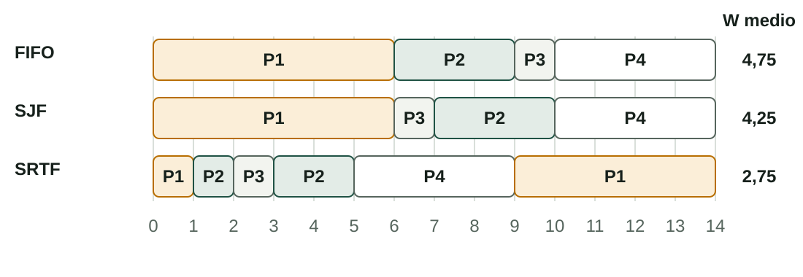
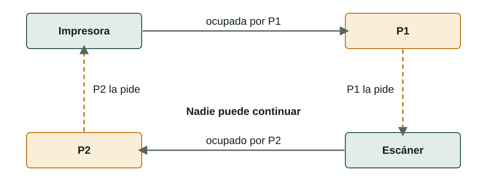

## Qué aprenderás

:::pasos
- Qué hacen el **planificador** y el **despachador**
- Cómo medir un algoritmo: **tiempo de finalización, de respuesta y de espera**
- **FIFO, SJF, SRTF, prioridades** y **Round Robin**, paso a paso
- **Inanición** y **envejecimiento**
- **Secciones críticas** e **interbloqueo**
:::

---

## Muchos procesos listos, pocos núcleos

:::pasos
- La **cola de listos** guarda los procesos que esperan la CPU
- Alguien debe decidir **cuál se ejecuta ahora** y **durante cuánto tiempo**
- Es el **planificador**: su decisión cambia lo rápido que se siente el ordenador
:::

---

## Tres planificadores y un despachador


---

## Qué hace cada uno

:::pasos
- **A largo plazo**: qué programas nuevos se **admiten** en el sistema
- **A medio plazo**: mueve procesos **RAM ⇄ disco** (*swapping*)
- **A corto plazo** (el planificador de la CPU): elige el siguiente proceso, **muchas veces por segundo**
- **Despachador**: el código que le da la CPU y hace el **cambio de contexto**
:::

---

## Expulsivo o no expulsivo

:::pasos
- **No expulsivo**: un proceso conserva la CPU hasta que **termina o espera E/S**
- **Expulsivo**: el SO puede **quitarle la CPU** (se acaba el tiempo, llega otro más importante)
- Todos los escritorios modernos son **expulsivos**
- Si no, un programa que nunca termina **congelaría el ordenador**
:::

---

## Datos para simular un algoritmo

:::pasos
- **Tiempo de llegada (A)**: cuándo entra el proceso en la cola de listos
- **Tiempo de ráfaga (B)**: el tiempo total de CPU que necesita (ignoramos la E/S)
- **Prioridad**: solo para los algoritmos de prioridades
- En este curso, un **número menor significa prioridad mayor**
:::

---

## Tres medidas por proceso

| Medida | Fórmula | Significado |
|---|---|---|
| **Finalización** (C) | Se lee en el diagrama de Gantt | Cuándo acaba el proceso |
| **Respuesta** (R) | C − A | Desde la llegada hasta tener el resultado |
| **Espera** (W) | R − B | Tiempo en la cola de listos, sin ejecutarse |

Después, los **promedios** de W y R. El laboratorio llama *Retraso de inicio* al tiempo hasta el primer turno de CPU.

---

## Diagrama de Gantt y otras medidas

:::pasos
- **Diagrama de Gantt**: una línea de tiempo que muestra quién tiene la CPU en cada unidad
- **Utilización de la CPU**: porcentaje de tiempo que trabaja
- **Rendimiento** (*throughput*): procesos terminados por unidad de tiempo
- **Cambios de contexto**: cada uno malgasta algo de tiempo
:::

---

## La carga de ejemplo

| Proceso | Llegada (A) | Ráfaga (B) | Prioridad |
|---|---|---|---|
| P1 | 0 | 6 | 4 |
| P2 | 1 | 3 | 1 |
| P3 | 2 | 1 | 3 |
| P4 | 3 | 4 | 2 |

Tiempo total de CPU: 6 + 3 + 1 + 4 = **14 unidades**; todos los algoritmos acaban en el instante 14.

---

## FIFO: primero en llegar, primero en salir

:::pasos
- Los procesos se ejecutan por **orden de llegada**; **no expulsivo**
- Sencillo, pero un proceso largo al frente hace esperar a los demás: **efecto convoy**
:::

```text
P1 [0-6]  P2 [6-9]  P3 [9-10]  P4 [10-14]
```

Espera media **4,75** · respuesta **8,25** · 3 cambios de contexto

---

## SJF: primero el trabajo más corto

:::pasos
- Con la CPU libre, se ejecuta el proceso listo con la **ráfaga más corta**
- **No expulsivo**; mejor espera media entre los no expulsivos
- Necesita la ráfaga **de antemano**; los largos pueden esperar **para siempre**
:::

```text
P1 [0-6]  P3 [6-7]  P2 [7-10]  P4 [10-14]
```

Espera media **4,25** · respuesta **7,75**

---

## SRTF: primero el menor tiempo restante

:::pasos
- La versión **expulsiva** de SJF
- La CPU va al proceso con **menos tiempo restante**
- Un proceso nuevo con menos tiempo restante **se queda la CPU**
:::

```text
P1 [0-1] P2 [1-2] P3 [2-3] P2 [3-5] P4 [5-9] P1 [9-14]
```

Espera media **2,75** · respuesta **6,25** · 5 cambios de contexto

---

## SRTF paso a paso

:::pasos
- t = 1: llega P2 con 3; a P1 le quedan 5, así que **P2 lo expulsa**
- t = 2: llega P3 con 1; a P2 le quedan 2, así que **P3 lo expulsa**; acaba en 3
- t = 3: llega P4; P2 (2) es el más corto y acaba en 5
- t = 5: P4 (4) gana a P1 (5) y se ejecuta hasta 9
- Después, **P1** termina en 14
:::

---

## Diagramas de Gantt: FIFO, SJF y SRTF



---

## Prioridades

:::pasos
- La CPU va al proceso listo de **mayor prioridad** (número menor)
- Misma prioridad: decide **FIFO**
- **No expulsivo**: P1 corre hasta 6; después P2, P4, P3. Espera media **5,50**
- **Expulsivo**: P2 quita la CPU a P1 en t = 1. Espera media **3,75**
:::

---

## Round Robin: una porción para cada proceso

:::pasos
- Cada proceso recibe un **quantum** (q), en el orden de la cola de listos
- ¿No ha terminado? Va al **final de la cola**
- ¿Termina antes? El siguiente proceso empieza **enseguida**
- **Expulsivo**; la base de los sistemas de tiempo compartido
:::

---

## Una convención que debes conocer

:::note[Una convención que debes conocer]
Un proceso nuevo llega **justo cuando** acaba un quantum. ¿Cuál entra primero en la cola?

En este curso y en el laboratorio: **primero el nuevo**, después el que fue expulsado.

Usa esta regla salvo que el ejercicio diga otra cosa.
:::

---

## Round Robin con q = 2 (1/2)

| Tiempo | Se ejecuta | Cola después (el frente a la izquierda) |
|---|---|---|
| 0–2 | P1 (6 → 4) | P2, P3, P1 |
| 2–4 | P2 (3 → 1) | P3, P1, P4, P2 |
| 4–5 | P3 (1 → 0) | P1, P4, P2 |
| 5–7 | P1 (4 → 2) | P4, P2, P1 |

P3 llega en 2 y entra **antes** que P1; P3 acaba antes de agotar el quantum.

---

## Round Robin con q = 2 (2/2)

| Tiempo | Se ejecuta | Cola después (el frente a la izquierda) |
|---|---|---|
| 7–9 | P4 (4 → 2) | P2, P1, P4 |
| 9–10 | P2 (1 → 0) | P1, P4 |
| 10–12 | P1 (2 → 0) | P4 |
| 12–14 | P4 (2 → 0) | vacía |

Espera media **5,25** · respuesta **8,75** · 7 cambios de contexto

---

## Diagramas de Gantt: prioridades y Round Robin


---

## El quantum importa

:::pasos
- Un quantum **enorme**: Round Robin se comporta como **FIFO**
- Un quantum **diminuto**: más tiempo **cambiando** que trabajando
- Un quantum real son unos **milisegundos**
:::

---

## Comparación (1/2)

| Algoritmo | Espera media | Respuesta media | Problema principal |
|---|---|---|---|
| FIFO | 4,75 | 8,25 | Efecto convoy |
| SJF (no expulsivo) | 4,25 | 7,75 | Necesita la ráfaga; inanición |
| SRTF (expulsivo) | 2,75 | 6,25 | Necesita la ráfaga; inanición |

---

## Comparación (2/2)

| Algoritmo | Espera media | Respuesta media | Problema principal |
|---|---|---|---|
| Prioridades (no expulsivo) | 5,50 | 9,00 | Inanición |
| Prioridades (expulsivo) | 3,75 | 7,25 | Inanición |
| Round Robin (q = 2) | 5,25 | 8,75 | Muchos cambios de contexto |

Ningún algoritmo es el mejor para todo; **Round Robin es más justo**: nadie espera mucho sin ejecutarse.

---

## Qué hacen los sistemas reales

:::pasos
- **Colas multinivel con realimentación**: prioridades más Round Robin
- Una cola por prioridad; se ejecuta siempre de la **más alta no vacía**
- Dentro de un nivel: **Round Robin**
- El sistema **cambia las prioridades**: pierde la que acapara CPU, gana la que espera teclado o disco
- Windows: 32 niveles; Linux: un planificador **justo** según el valor nice
:::

---

## Inanición y envejecimiento

:::pasos
- Un proceso puede esperar **para siempre** si siguen llegando otros más importantes o más cortos
- Eso es la **inanición**
- La solución es el **envejecimiento**: cuanto más espera, **más sube su prioridad**
:::

---

## Compartir recursos: secciones críticas

:::pasos
- Los procesos **independientes** trabajan solos; los **cooperantes** comparten algo
- Dos procesos imprimen en la misma impresora: **líneas mezcladas**
- Dos procesos suman 1 a una variable: **se pierde una actualización**
- Es una **condición de carrera**: el resultado depende del orden del planificador
:::

---

## Exclusión mutua

:::pasos
- El código que usa el recurso compartido es la **sección crítica**
- Solo **un proceso** puede estar en ella a la vez
- El SO ofrece **cerrojos (mutex)** y **semáforos**
:::

---

## Cómo funciona un cerrojo

:::pasos
1. Un proceso **pide el cerrojo** antes de entrar
2. ¿Cerrojo ocupado? El proceso pasa a **Bloqueado**
3. El dueño lo **libera**; el proceso en espera pasa a **Listo**
:::

---

## Interbloqueo: esperarse para siempre



---

## Cuatro condiciones para un interbloqueo

| Condición | Significado en el ejemplo |
|---|---|
| **Exclusión mutua** | Un solo proceso a la vez por recurso |
| **Retención y espera** | Conserva lo que tiene mientras espera más |
| **Sin expropiación** | No se puede quitar un recurso |
| **Espera circular** | P1 espera a P2 y P2 a P1 |

---

## Rompe una condición

:::pasos
- Rompe **una** condición y el interbloqueo **no puede ocurrir**
- Lo más fácil: todos piden los recursos **en el mismo orden**
- Otras opciones: pedir **todo a la vez**, permitir quitar un recurso, o **detectarlo y terminar** un proceso
- Muchos escritorios no hacen nada y esperan que el usuario **cierre el programa congelado**
:::

---

## Pruébalo (1/3)

::laboratorio[Simulador del planificador]{src="planificador-de-procesos" pestana="scheduler"}

---

## Pruébalo (2/3)

::laboratorio[Duelo de algoritmos]{src="planificador-de-procesos" pestana="shootout"}

---

## Pruébalo (3/3)

::laboratorio[Sección crítica e interbloqueo]{src="planificador-de-procesos" pestana="sync"}

---

## Resumen

- El **planificador a corto plazo** elige el siguiente proceso; el **despachador** cambia
- Mide **C, R = C − A y W = R − B** con un diagrama de Gantt
- **SJF/SRTF** y las **prioridades** pueden causar inanición; el **envejecimiento** la evita
- **Round Robin** reparte la CPU en quantums; los sistemas reales usan **colas con realimentación**
- La **exclusión mutua** evita las carreras; **ordenar los recursos** evita el interbloqueo

[Actividades de la unidad →](/docencia/smr/som/ud03-funciones-sistema-operativo/actividades/es/)

---

## Créditos

Estas diapositivas resumen los apuntes del curso de SOM de Moisés Mas Rocamora, Daniel Álvarez Santamaría y Jana Taboada León, con licencia **CC BY-NC-SA 4.0**. Se comparten con la misma licencia.
