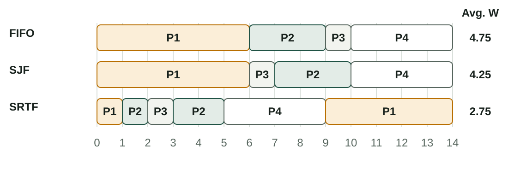
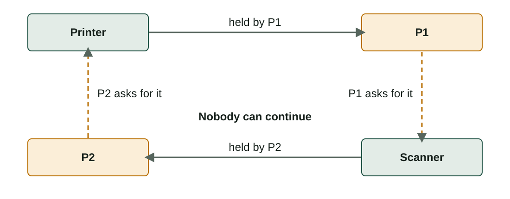

## What you will learn

:::pasos
- What the **scheduler** and the **dispatcher** do
- How to measure an algorithm: **completion, response, waiting time**
- **FIFO, SJF, SRTF, priorities** and **Round Robin**, step by step
- **Starvation** and **aging**
- **Critical sections** and **deadlock**
:::

---

## Many ready processes, few cores

:::pasos
- The **ready queue** holds the processes that wait for the CPU
- Someone must decide **which runs next** and **for how long**
- That is the **scheduler**: its choice changes how fast the computer feels
:::

---

## Three schedulers and a dispatcher


---

## What each one does

:::pasos
- **Long-term**: which new programs are **admitted** into the system
- **Medium-term**: moves processes **RAM ⇄ disk** (*swapping*)
- **Short-term** (the CPU scheduler): chooses the next process, **many times per second**
- **Dispatcher**: the code that gives it the CPU and makes the **context switch**
:::

---

## Preemptive or non-preemptive

:::pasos
- **Non-preemptive**: a process keeps the CPU until it **ends or waits for I/O**
- **Preemptive**: the OS can **take the CPU** (time over, more important process)
- All modern desktops are **preemptive**
- Otherwise a program that never ends would **freeze the computer**
:::

---

## Data to simulate an algorithm

:::pasos
- **Arrival time (A)**: when the process enters the ready queue
- **Burst time (B)**: the total CPU time it needs (we ignore I/O)
- **Priority**: only for priority algorithms
- In this course, a **lower number means higher priority**
:::

---

## Three measures per process

| Measure | Formula | Meaning |
|---|---|---|
| **Completion** (C) | From the Gantt chart | When the process ends |
| **Response** (R) | C − A | From arrival until the result is ready |
| **Waiting** (W) | R − B | Time in the ready queue, not running |

Then the **averages** of W and R. The lab calls the time until the first CPU turn *Start delay*.

---

## Gantt chart and other measures

:::pasos
- **Gantt chart**: a time line showing who owns the CPU in each time unit
- **CPU utilisation**: percentage of time the CPU is working
- **Throughput**: processes finished per unit of time
- **Context switches**: each one wastes some time
:::

---

## The example load

| Process | Arrival (A) | Burst (B) | Priority |
|---|---|---|---|
| P1 | 0 | 6 | 4 |
| P2 | 1 | 3 | 1 |
| P3 | 2 | 1 | 3 |
| P4 | 3 | 4 | 2 |

Total CPU time: 6 + 3 + 1 + 4 = **14 units**; every algorithm ends at time 14.

---

## FIFO: first in, first out

:::pasos
- Processes run in **order of arrival**; **non-preemptive**
- Simple, but a long process at the front makes the rest wait: **convoy effect**
:::

```text
P1 [0-6]  P2 [6-9]  P3 [9-10]  P4 [10-14]
```

Average waiting **4.75** · response **8.25** · 3 context switches

---

## SJF: shortest job first

:::pasos
- When the CPU is free, run the ready process with the **shortest burst**
- **Non-preemptive**; best average waiting among non-preemptive
- Needs the burst **in advance**; long processes can wait **forever**
:::

```text
P1 [0-6]  P3 [6-7]  P2 [7-10]  P4 [10-14]
```

Average waiting **4.25** · response **7.75**

---

## SRTF: shortest remaining time first

:::pasos
- The **preemptive** version of SJF
- The CPU goes to the process with the **least remaining time**
- A new process with less remaining time **takes the CPU**
:::

```text
P1 [0-1] P2 [1-2] P3 [2-3] P2 [3-5] P4 [5-9] P1 [9-14]
```

Average waiting **2.75** · response **6.25** · 5 context switches

---

## SRTF step by step

:::pasos
- t = 1: P2 arrives with 3; P1 has 5 left, so **P2 preempts**
- t = 2: P3 arrives with 1; P2 has 2 left, so **P3 preempts**; it ends at 3
- t = 3: P4 arrives; P2 (2) is the shortest and ends at 5
- t = 5: P4 (4) beats P1 (5) and runs until 9
- Then **P1** finishes at 14
:::

---

## Gantt charts: FIFO, SJF and SRTF



---

## Priorities

:::pasos
- The CPU goes to the ready process with the **highest priority** (lowest number)
- Same priority: **FIFO** decides
- **Non-preemptive**: P1 runs to 6; then P2, P4, P3. Average waiting **5.50**
- **Preemptive**: P2 takes the CPU from P1 at t = 1. Average waiting **3.75**
:::

---

## Round Robin: a slice for each process

:::pasos
- Each process gets a **quantum** (q), in ready-queue order
- Not finished? It goes to the **end of the queue**
- Finished early? The next process starts **at once**
- **Preemptive**; the base of time-sharing systems
:::

---

## A convention you must know

:::note[A convention you must know]
A new process arrives **at the same moment** a quantum ends. Which enters the queue first?

In this course and in the lab: **the new process first**, then the one that was preempted.

Use this rule unless the exercise says otherwise.
:::

---

## Round Robin with q = 2 (1/2)

| Time | Runs | Queue after (front on the left) |
|---|---|---|
| 0–2 | P1 (6 → 4) | P2, P3, P1 |
| 2–4 | P2 (3 → 1) | P3, P1, P4, P2 |
| 4–5 | P3 (1 → 0) | P1, P4, P2 |
| 5–7 | P1 (4 → 2) | P4, P2, P1 |

P3 arrives at 2 and enters **before** P1; P3 ends before the quantum is over.

---

## Round Robin with q = 2 (2/2)

| Time | Runs | Queue after (front on the left) |
|---|---|---|
| 7–9 | P4 (4 → 2) | P2, P1, P4 |
| 9–10 | P2 (1 → 0) | P1, P4 |
| 10–12 | P1 (2 → 0) | P4 |
| 12–14 | P4 (2 → 0) | empty |

Average waiting **5.25** · response **8.75** · 7 context switches

---

## Gantt charts: priorities and Round Robin


---

## The quantum matters

:::pasos
- A **huge** quantum: Round Robin behaves like **FIFO**
- A **tiny** quantum: more time **switching** than working
- A real quantum is some **milliseconds**
:::

---

## Comparison (1/2)

| Algorithm | Avg. waiting | Avg. response | Main problem |
|---|---|---|---|
| FIFO | 4.75 | 8.25 | Convoy effect |
| SJF (non-preemptive) | 4.25 | 7.75 | Needs the burst; starvation |
| SRTF (preemptive) | 2.75 | 6.25 | Needs the burst; starvation |

---

## Comparison (2/2)

| Algorithm | Avg. waiting | Avg. response | Main problem |
|---|---|---|---|
| Priorities (non-preemptive) | 5.50 | 9.00 | Starvation |
| Priorities (preemptive) | 3.75 | 7.25 | Starvation |
| Round Robin (q = 2) | 5.25 | 8.75 | Many context switches |

No algorithm is the best for everything; **Round Robin is fairer**: nobody waits long without running.

---

## What real systems do

:::pasos
- **Multilevel queues with feedback**: priorities plus Round Robin
- A queue per priority; always run from the **highest non-empty** one
- Inside a level: **Round Robin**
- The system **changes priorities**: CPU-hungry loses, waiting for keyboard or disk wins
- Windows: 32 levels; Linux: a **fair** scheduler by nice value
:::

---

## Starvation and aging

:::pasos
- A process can wait **forever** if more important or shorter ones keep arriving
- That is **starvation**
- The fix is **aging**: the longer it waits, the **higher its priority** grows
:::

---

## Sharing resources: critical sections

:::pasos
- **Independent** processes work alone; **cooperating** ones share something
- Two processes print on the same printer: **mixed lines**
- Two processes add 1 to a variable: **one update is lost**
- This is a **race condition**: the result depends on the scheduler's order
:::

---

## Mutual exclusion

:::pasos
- The code that uses the shared resource is the **critical section**
- Only **one process** can be in it at a time
- The OS offers **locks (mutex)** and **semaphores**
:::

---

## How a lock works

:::pasos
1. A process **asks for the lock** before entering
2. Lock taken? The process goes to **Waiting**
3. The owner **releases** it; the waiting process goes to **Ready**
:::

---

## Deadlock: waiting for each other forever



---

## Four conditions for a deadlock

| Condition | Meaning in the example |
|---|---|
| **Mutual exclusion** | One process at a time per resource |
| **Hold and wait** | Keeps what it has while waiting for more |
| **No preemption** | You cannot take a resource away |
| **Circular wait** | P1 waits for P2 and P2 for P1 |

---

## Break one condition

:::pasos
- Break **one** condition and deadlock **cannot happen**
- Easiest: all processes ask for resources **in the same order**
- Other options: ask for **everything at once**, allow taking a resource away, or **detect and end** a process
- Many desktops do nothing and rely on the user to **close the frozen program**
:::

---

## Try it yourself (1/3)

::laboratorio[Scheduler simulator]{src="planificador-de-procesos" pestana="scheduler"}

---

## Try it yourself (2/3)

::laboratorio[Algorithm shoot-out]{src="planificador-de-procesos" pestana="shootout"}

---

## Try it yourself (3/3)

::laboratorio[Critical section & deadlock]{src="planificador-de-procesos" pestana="sync"}

---

## Summary

- The **short-term scheduler** picks the next process; the **dispatcher** switches
- Measure **C, R = C − A and W = R − B** with a Gantt chart
- **SJF/SRTF** and **priorities** can starve; **aging** fixes it
- **Round Robin** shares the CPU in quanta; real systems use **feedback queues**
- **Mutual exclusion** avoids races; **ordering resources** avoids deadlock

[Activities of the unit →](/docencia/smr/som/ud03-funciones-sistema-operativo/actividades/)

---

## Credits

These slides summarise the SOM course notes by Moisés Mas Rocamora, Daniel Álvarez Santamaría and Jana Taboada León, licensed under **CC BY-NC-SA 4.0**. They are shared under the same licence.
