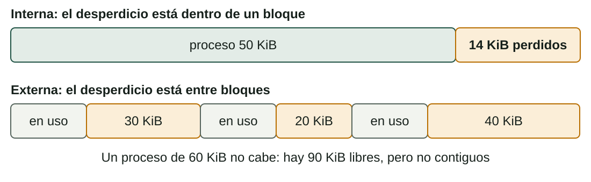
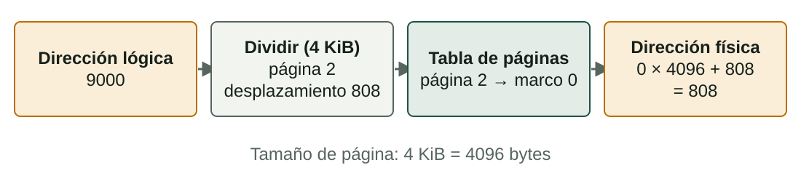
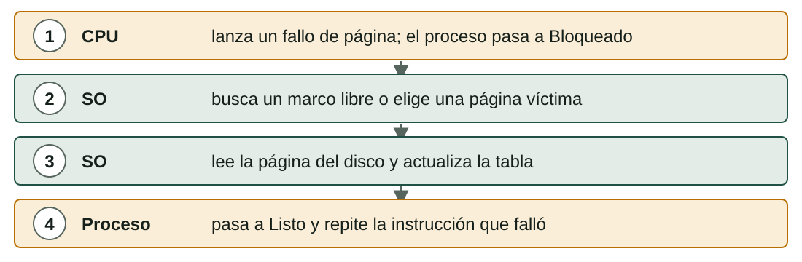

## Qué aprenderás

:::pasos
- Las **cinco tareas** del gestor de memoria
- Direcciones **lógicas** y **físicas**
- **Fragmentación**, **paginación** y **segmentación**, con cálculos
- **Memoria virtual**, **fallos de página** y **reemplazo de páginas**
- Cómo **comprobar y optimizar** el uso de memoria
:::

---

## Cinco tareas del gestor de memoria

:::pasos
1. Saber qué partes de la RAM están **libres** y cuáles **en uso**
2. **Asignar** memoria a cada proceso y recuperarla cuando termina
3. **Proteger**: ningún proceso lee ni escribe la memoria de otro
4. Permitir **compartir** cuando es útil
5. Mover datos entre **RAM y disco** cuando la RAM no basta
:::

---

## Direcciones lógicas y físicas

:::pasos
- Un proceso ve **direcciones lógicas (virtuales)**, que empiezan en **0**
- La posición real en la RAM es la **dirección física**
- La **MMU** traduce una en otra en cada acceso
- El SO puede poner un proceso **donde sea**, incluso moverlo, y el programa no lo nota
:::

---

## Asignación contigua

:::pasos
- Idea más simple: **un bloque** de memoria continua por proceso
- **Particiones fijas**: RAM dividida de antemano; fácil, pero un proceso rara vez llena su partición
- **Particiones variables**: cada proceso recibe exactamente lo que pide
- Ambas pierden memoria: **fragmentación**
:::

---

## Dos tipos de fragmentación



---

## ¿Interna o externa?

| | Interna | Externa |
|---|---|---|
| Dónde | **Dentro** de un bloque asignado | **Entre** bloques |
| Causa | Bloques o particiones de tamaño fijo | Bloques de tamaño variable que aparecen y desaparecen |
| Solución | Bloques más pequeños | **Compactación** (lenta) |

La compactación junta los procesos; los sistemas modernos evitan el problema con la **paginación**.

---

## Paginación: páginas y marcos

:::pasos
- La memoria lógica se divide en bloques iguales: **páginas**
- La RAM física se divide en bloques del mismo tamaño: **marcos**
- **Cualquier página** puede ir a **cualquier marco libre**
- Una **tabla de páginas** por proceso dice qué marco tiene cada página
:::

---

## La paginación en un dibujo


---

## Número de página y desplazamiento

```text
número de página  = dirección lógica  div  tamaño de página
desplazamiento    = dirección lógica  mod  tamaño de página
dirección física  = número de marco × tamaño de página + desplazamiento
```

---

## Ejemplo resuelto: dirección lógica 9000



---

## Si la tabla de páginas dijera marco 5

:::pasos
- Página 2 en el marco **5**: 5 × 4096 + 808 = **21288**
- El **desplazamiento** nunca cambia; solo cambia el marco
:::

---

## Fragmentación en la paginación

:::pasos
- **Nada de fragmentación externa**: todos los marcos tienen el mismo tamaño
- Un poco de fragmentación **interna**, solo en la **última página**
- Ejemplo: 18 KiB necesitan ⌈18 / 4⌉ = **5 páginas** (20 KiB) y desperdician **2 KiB**
- **Páginas pequeñas** desperdician menos pero hacen la tabla de páginas **mayor**
- Tamaño típico: **4 KiB**
:::

---

## Segmentación

:::pasos
- El proceso se divide en partes lógicas de **distinto tamaño**: código, datos, pila
- Cada **segmento** tiene una **base** (inicio en la RAM) y un **límite** (longitud)
- Una dirección lógica es un par **(segmento, desplazamiento)**
:::

---

## Ejemplo de tabla de segmentos

| Segmento | Contenido | Base | Límite |
|---|---|---|---|
| 0 | Código | 4000 | 1500 |
| 1 | Datos | 9000 | 800 |
| 2 | Pila | 20000 | 2000 |

---

## Comprobar una dirección

:::pasos
- **(1, 500)**: 500 < 800, válida; física = 9000 + 500 = **9500**
- **(1, 900)**: 900 ≥ 800, fuera del segmento
- El hardware lanza un error; el SO termina el proceso
- En Linux: **Segmentation fault** (fallo de segmentación)
:::

---

## ¿Paginación o segmentación?

| | Paginación | Segmentación |
|---|---|---|
| Tamaño del bloque | Fijo (páginas, marcos) | Variable (segmentos) |
| Visible para el programador | No | Sí: código, datos, pila |
| Dirección | página + desplazamiento | segmento + desplazamiento |
| Fragmentación | Interna, pequeña | Externa |

Algunos sistemas **combinan** ambas: segmentos divididos en páginas.

---

## Memoria virtual

:::pasos
- Los programas pueden necesitar más memoria que la RAM disponible
- El SO usa parte del **disco** como ampliación de la RAM
- Linux: partición o archivo de **intercambio** (*swap*); Windows: **archivo de paginación** (`pagefile.sys`)
- **Paginación por demanda**: una página entra en la RAM **solo cuando se necesita**
:::

---

## Qué ocurre en un fallo de página



---

## Hiperpaginación

:::pasos
- Un fallo de página es **muy lento**: el disco es miles de veces más lento que la RAM
- Con poca RAM, el sistema pasa el tiempo **moviendo páginas**
- Es la **hiperpaginación** (*thrashing*): la luz del disco siempre encendida, programas lentísimos
:::

---

## Reemplazo de páginas: elegir una víctima

:::pasos
- Con la RAM llena, el SO retira una página **víctima**
- **FIFO**: retira la página que lleva **más tiempo** en memoria; puede ser una que usas siempre
- **LRU** (menos usada recientemente): retira la página **sin usar desde hace más**
- LRU da menos fallos pero cuesta más; los sistemas reales la **aproximan**
:::

---

## Ejemplo: FIFO frente a LRU

Cadena de referencias: `3 2 3 5 4 3 5 5 1 5 2 1` · **3 marcos**

| Ref | FIFO (la más antigua primero) | LRU (la menos reciente primero) |
|---|---|---|
| 3 | 3 **F** | 3 **F** |
| 2 | 3, 2 **F** | 3, 2 **F** |
| 3 | 3, 2 | 2, 3 |
| 5 | 3, 2, 5 **F** | 2, 3, 5 **F** |

**F** es un fallo de página.

---

## FIFO frente a LRU (2/3)

| Ref | FIFO (la más antigua primero) | LRU (la menos reciente primero) |
|---|---|---|
| 4 | 2, 5, 4 **F** | 3, 5, 4 **F** |
| 3 | 5, 4, 3 **F** | 5, 4, 3 |
| 5 | 5, 4, 3 | 4, 3, 5 |
| 5 | 5, 4, 3 | 4, 3, 5 |

---

## FIFO frente a LRU (3/3)

| Ref | FIFO (la más antigua primero) | LRU (la menos reciente primero) |
|---|---|---|
| 1 | 4, 3, 1 **F** | 3, 5, 1 **F** |
| 5 | 3, 1, 5 **F** | 3, 1, 5 |
| 2 | 1, 5, 2 **F** | 1, 5, 2 **F** |
| 1 | 1, 5, 2 | 5, 2, 1 |
| **Fallos** | **8** | **6** |

---

## ¿Más memoria ayuda siempre?

:::note[¿Más memoria ayuda siempre?]
No con FIFO. Con `1 2 3 4 1 2 5 1 2 3 4 5`, FIFO da **9 fallos** con 3 marcos y **10** con 4.

Es la **anomalía de Belady**. LRU nunca tiene este problema.
:::

---

## Comprobar la memoria en Linux

| Herramienta | Qué mirar |
|---|---|
| `free -h` | Columna **available**; un *free* bajo es normal (caché de disco) |
| `top` (tecla `M`) | `RES` por proceso; la línea `MiB Swap` |
| `vmstat 1` | `si` y `so`: si nunca son cero, el sistema hace swap |
| `swapon --show` | Qué áreas de swap hay y cuánto se usan |

---

## Comprobar la memoria en Windows

| Herramienta | Qué mirar |
|---|---|
| Administrador de tareas → Rendimiento → Memoria | En uso, Disponible, Confirmada, En caché |
| Administrador de tareas → Procesos (ordenar por Memoria) | Qué programas usan más RAM |
| Monitor de recursos (`resmon`) | Pestaña *Memoria*, *Errores de página físicos/s* |

---

## Optimizar la memoria

:::pasos
- **Cierra o reinicia** los programas que usan demasiado; muchas pestañas del navegador son la causa habitual
- **Reduce los programas de inicio**
- Usa **software más ligero** en equipos viejos
- **Añade RAM** si ves swap constante
- **Mantén activada la memoria virtual**
- Un sistema de **32 bits** solo direcciona 4 GiB: usa 64 bits
:::

---

## El swap no sustituye a la RAM

:::caution[El swap no sustituye a la RAM]
El disco es mucho más lento que la RAM, incluso un SSD.

El swap evita que el sistema se caiga con la RAM llena, pero no hará rápido el ordenador. Si haces swap todo el tiempo, **necesitas más RAM**.
:::

---

## Practica los cálculos

:::pasos
- El laboratorio de esta unidad **no tiene pestaña de memoria**: los cálculos son la práctica
- **Número de página y desplazamiento**, y la dirección física
- **Límites de segmento** y recuento de **fallos de página**
- Repítelos **en papel**, con calculadora
:::

---

## Resumen

- El gestor de memoria **asigna, protege, comparte** y mueve datos al disco
- La **paginación** elimina la fragmentación externa; la **segmentación** sigue las partes del programa
- **Dirección física** = marco × tamaño de página + desplazamiento
- La **memoria virtual** usa disco; demasiados **fallos de página** causan hiperpaginación
- **LRU** suele superar a **FIFO**; el **swap** no sustituye a la RAM

[Actividades de la unidad →](/docencia/smr/som/ud03-funciones-sistema-operativo/actividades/es/)

---

## Créditos

Estas diapositivas resumen los apuntes del curso de SOM de Moisés Mas Rocamora, Daniel Álvarez Santamaría y Jana Taboada León, con licencia **CC BY-NC-SA 4.0**. Se comparten con la misma licencia.
