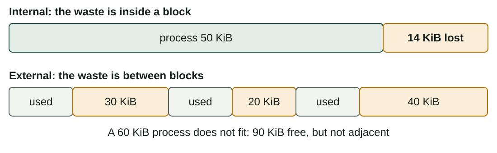
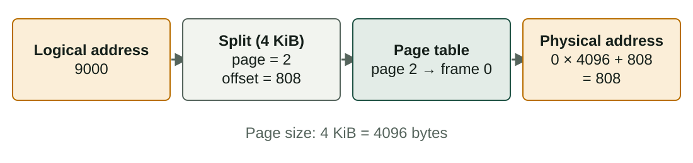
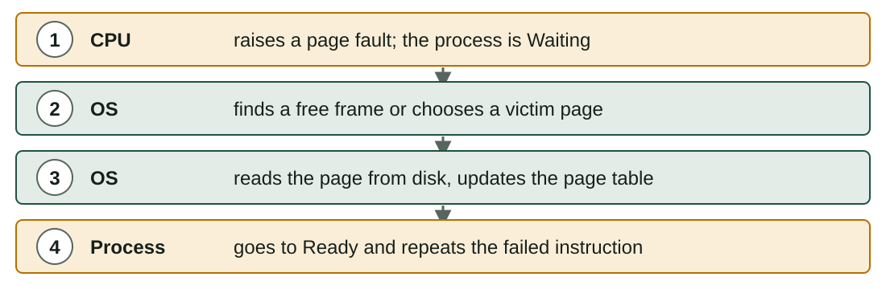

## What you will learn

:::pasos
- The **five jobs** of the memory manager
- **Logical** and **physical** addresses
- **Fragmentation**, **paging** and **segmentation**, with calculations
- **Virtual memory**, **page faults** and **page replacement**
- How to **check and optimise** memory use
:::

---

## Five jobs of the memory manager

:::pasos
1. Know which parts of RAM are **free** and which are **used**
2. **Assign** memory to each process and take it back when it ends
3. **Protect**: no process reads or writes another's memory
4. Allow **sharing** when it is useful
5. Move data between **RAM and disk** when RAM is not enough
:::

---

## Logical and physical addresses

:::pasos
- A process sees **logical (virtual) addresses**, starting at **0**
- The real position in RAM is the **physical address**
- The **MMU** translates one into the other at every access
- The OS can put a process **anywhere**, even move it, and the program does not notice
:::

---

## Contiguous allocation

:::pasos
- Simplest idea: **one block** of continuous memory per process
- **Fixed partitions**: RAM divided in advance; easy, but a process rarely fills its partition
- **Variable partitions**: each process gets exactly what it asks for
- Both lose memory: **fragmentation**
:::

---

## Two kinds of fragmentation



---

## Internal or external?

| | Internal | External |
|---|---|---|
| Where | **Inside** an assigned block | **Between** blocks |
| Cause | Fixed-size blocks or partitions | Variable-size blocks that appear and disappear |
| Solution | Smaller blocks | **Compaction** (slow) |

Compaction moves processes together; modern systems avoid the problem with **paging**.

---

## Paging: pages and frames

:::pasos
- Logical memory is divided into equal blocks: **pages**
- Physical RAM is divided into blocks of the same size: **frames**
- **Any page** can go into **any free frame**
- A **page table** per process says which frame holds each page
:::

---

## Paging in a picture


---

## Page number and offset

```text
page number = logical address  div  page size
offset      = logical address  mod  page size
physical address = frame number × page size + offset
```

---

## Worked example: logical address 9000



---

## If the page table said frame 5

:::pasos
- Page 2 in frame **5**: 5 × 4096 + 808 = **21288**
- The **offset** never changes; only the frame does
:::

---

## Fragmentation in paging

:::pasos
- **No external** fragmentation: every frame has the same size
- A little **internal** fragmentation, only in the **last page**
- Example: 18 KiB needs ⌈18 / 4⌉ = **5 pages** (20 KiB) and wastes **2 KiB**
- **Small pages** waste less but make the page table **bigger**
- Typical size: **4 KiB**
:::

---

## Segmentation

:::pasos
- The process is divided into logical parts of **different size**: code, data, stack
- Each **segment** has a **base** (start in RAM) and a **limit** (length)
- A logical address is a pair **(segment, offset)**
:::

---

## Segment table example

| Segment | Content | Base | Limit |
|---|---|---|---|
| 0 | Code | 4000 | 1500 |
| 1 | Data | 9000 | 800 |
| 2 | Stack | 20000 | 2000 |

---

## Checking an address

:::pasos
- **(1, 500)**: 500 < 800, valid; physical = 9000 + 500 = **9500**
- **(1, 900)**: 900 ≥ 800, outside the segment
- The hardware raises an error; the OS ends the process
- In Linux: **Segmentation fault**
:::

---

## Paging or segmentation?

| | Paging | Segmentation |
|---|---|---|
| Block size | Fixed (pages, frames) | Variable (segments) |
| Visible to the programmer | No | Yes: code, data, stack |
| Address | page + offset | segment + offset |
| Fragmentation | Internal, small | External |

Some systems **combine** both: segments divided into pages.

---

## Virtual memory

:::pasos
- Programs may need more memory than the RAM you have
- The OS uses part of the **disk** as an extension of RAM
- Linux: **swap** partition or file; Windows: **page file** (`pagefile.sys`)
- **Demand paging**: a page enters RAM **only when needed**
:::

---

## What happens in a page fault



---

## Thrashing

:::pasos
- A page fault is **very slow**: the disk is thousands of times slower than RAM
- Too little RAM: the system spends its time **moving pages**
- That is **thrashing**: the disk light is always on, programs react slowly
:::

---

## Page replacement: choosing a victim

:::pasos
- When RAM is full, the OS removes a **victim** page
- **FIFO**: removes the page that has been in memory **longest**; it may be one you use all the time
- **LRU** (Least Recently Used): removes the page **unused for the longest**
- LRU gives fewer faults but costs more; real systems **approximate** it
:::

---

## Example: FIFO against LRU

Reference string: `3 2 3 5 4 3 5 5 1 5 2 1` · **3 frames**

| Ref | FIFO (oldest first) | LRU (least recent first) |
|---|---|---|
| 3 | 3 **F** | 3 **F** |
| 2 | 3, 2 **F** | 3, 2 **F** |
| 3 | 3, 2 | 2, 3 |
| 5 | 3, 2, 5 **F** | 2, 3, 5 **F** |

**F** is a page fault.

---

## FIFO against LRU (2/3)

| Ref | FIFO (oldest first) | LRU (least recent first) |
|---|---|---|
| 4 | 2, 5, 4 **F** | 3, 5, 4 **F** |
| 3 | 5, 4, 3 **F** | 5, 4, 3 |
| 5 | 5, 4, 3 | 4, 3, 5 |
| 5 | 5, 4, 3 | 4, 3, 5 |

---

## FIFO against LRU (3/3)

| Ref | FIFO (oldest first) | LRU (least recent first) |
|---|---|---|
| 1 | 4, 3, 1 **F** | 3, 5, 1 **F** |
| 5 | 3, 1, 5 **F** | 3, 1, 5 |
| 2 | 1, 5, 2 **F** | 1, 5, 2 **F** |
| 1 | 1, 5, 2 | 5, 2, 1 |
| **Faults** | **8** | **6** |

---

## Does more memory always help?

:::note[Does more memory always help?]
Not with FIFO. With `1 2 3 4 1 2 5 1 2 3 4 5`, FIFO gives **9 faults** with 3 frames and **10** with 4.

This is **Belady's anomaly**. LRU never has this problem.
:::

---

## Checking memory in Linux

| Tool | What to look at |
|---|---|
| `free -h` | Column **available**; a low *free* is normal (disk cache) |
| `top` (key `M`) | `RES` per process; the `MiB Swap` line |
| `vmstat 1` | `si` and `so`: if never zero, the system is swapping |
| `swapon --show` | Which swap areas exist and how full they are |

---

## Checking memory in Windows

| Tool | What to look at |
|---|---|
| Task Manager → Performance → Memory | In use, Available, Committed, Cached |
| Task Manager → Processes (sort by Memory) | Which programs use the most RAM |
| Resource Monitor (`resmon`) | *Memory* tab, *Hard Faults/sec* |

---

## Optimising memory

:::pasos
- **Close or restart** programs that use too much; many browser tabs are the usual cause
- **Reduce startup programs**
- Use **lighter software** on old computers
- **Add RAM** if you see constant swapping
- **Keep virtual memory enabled**
- A **32-bit** system addresses only 4 GiB: use 64-bit
:::

---

## Swap is not a replacement for RAM

:::caution[Swap is not a replacement for RAM]
Disk is much slower than RAM, even an SSD.

Swap saves the system from a crash when RAM is full, but it will not make the computer fast. If you swap all the time, **you need more RAM**.
:::

---

## Practise the calculations

:::pasos
- This unit's lab has **no memory tab**: the calculations are the practice
- **Page number and offset**, and the physical address
- **Segment** limits and **page-fault** counts
- Repeat them **on paper**, with a calculator
:::

---

## Summary

- The memory manager **assigns, protects, shares** and moves data to disk
- **Paging** removes external fragmentation; **segmentation** follows the program's parts
- **Physical address** = frame × page size + offset
- **Virtual memory** uses disk; too many **page faults** cause thrashing
- **LRU** usually beats **FIFO**; **swap** does not replace RAM

[Activities of the unit →](/docencia/smr/som/ud03-funciones-sistema-operativo/actividades/)

---

## Credits

These slides summarise the SOM course notes by Moisés Mas Rocamora, Daniel Álvarez Santamaría and Jana Taboada León, licensed under **CC BY-NC-SA 4.0**. They are shared under the same licence.
