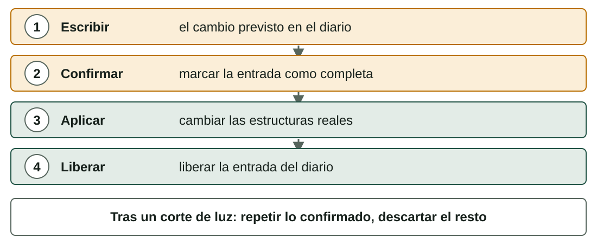

## Qué aprenderás

:::pasos
- Cómo está hecho un **disco**: sectores y clústeres
- **Particiones**, **MBR** y **GPT**
- **FAT32, exFAT, NTFS** y **ext4**, y cómo elegir
- Por qué el **journaling** salva tus datos tras un corte de luz
- Cómo **optimizar** el almacenamiento y escribir un **plan de instalación**
:::

---

## Dos tipos de disco

| | HDD | SSD |
|---|---|---|
| Tecnología | Platos magnéticos que giran y un cabezal móvil | Chips de memoria flash, sin piezas móviles |
| Velocidad | Lento para encontrar datos | Muy rápido, también en acceso aleatorio |
| Punto débil | Desgaste mecánico, golpes | Escrituras limitadas por celda |
| Fragmentación | Perjudica el rendimiento | No importa |

---

## Estructura física de un HDD

:::pasos
- **Platos** con dos caras
- Cada cara tiene **pistas** circulares, divididas en **sectores**
- La misma pista en todos los platos forma un **cilindro**
- Un **sector** es la unidad mínima que se lee o escribe: **512 bytes**, o 4096 en discos nuevos
:::

---

## Estructura lógica: clústeres y bloques

:::pasos
- El SO trabaja con **clústeres** (Windows) o **bloques** (Linux)
- Un clúster es un grupo de **sectores contiguos**
- Es la unidad mínima **asignada a un archivo**
- Por eso un archivo usa siempre un **número entero de clústeres**
:::

---

## Del disco a tus archivos

---

## El último clúster desperdicia espacio

Clústeres de 4096 bytes:

| Tamaño del archivo (bytes) | Clústeres | Espacio usado | Desperdiciado |
|---|---|---|---|
| 1.200 | 1 | 4.096 | 2.896 |
| 5.000 | 2 | 8.192 | 3.192 |
| 9.000 | 3 | 12.288 | 3.288 |
| 40.000 | 10 | 40.960 | 960 |
| **Total 55.200** | **16** | **65.536** | **10.336** |

---

## Elegir el tamaño de clúster

:::pasos
- Con clústeres de **32 KiB**, los mismos cuatro archivos necesitan **5 clústeres** y desperdician **108.640 bytes**
- **Clústeres grandes** desperdician espacio con archivos pequeños
- **Clústeres pequeños** necesitan una tabla de asignación mayor
- El tamaño se elige al **formatear**; el predeterminado suele ser bueno
:::

---

## ¿Por qué dividir un disco en particiones?

:::pasos
- Instalar **varios sistemas operativos** en un disco
- **Separar** el sistema de tus datos: reinstalar sin tocar los archivos
- Usar **sistemas de archivos distintos**
- Proteger el sistema: una partición de datos llena no detiene el SO
:::

---

## Dos formatos de tabla de particiones

---

## MBR (Master Boot Record)

:::pasos
- De los años 80; funciona con la **BIOS**
- Primer sector: programa de arranque, **cuatro entradas** y una firma
- Máximo **cuatro particiones primarias**; o una **extendida** con particiones **lógicas**
- Discos limitados a **2 TiB**
- Solo **una copia** de la tabla
:::

---

## GPT (GUID Partition Table)

:::pasos
- El formato moderno, con **UEFI**
- Un **MBR de protección** en el primer sector, para herramientas antiguas
- Cabecera y entradas (128 por defecto en Windows), con una **copia** al final
- Todas las particiones del mismo tipo, cada una con un **GUID**
- Discos de muchos terabytes
:::

---

## ¿MBR o GPT?

| | MBR | GPT |
|---|---|---|
| Firmware | BIOS (heredada) | UEFI |
| Particiones | 4 primarias, o 3 + extendida | Hasta 128 en Windows |
| Disco máximo | 2 TiB | Prácticamente ilimitado |
| Copias de la tabla | 1 | 2 (inicio y final) |

Un sistema UEFI necesita una **partición del sistema EFI** (FAT32, de 100 MB a 1 GB) para los gestores de arranque.

---

## Nombres de las particiones

:::pasos
- **Windows**: una **letra de unidad** por volumen, `C:`, `D:`…
- **Linux**: un único árbol; dispositivos `/dev/sda`, particiones `/dev/sda1`, `/dev/nvme0n1p1`
- Para usar una partición en Linux, la **montas** en una carpeta (`/home`, `/media/usb`)
:::

---

## LVM en Linux

:::pasos
- Une discos o particiones (**volúmenes físicos**) en un **grupo de volúmenes**
- De él cortas **volúmenes lógicos**
- Puedes **ampliar** un volumen lógico después, incluso añadiendo un disco nuevo
- Sin mover datos
:::

---

## Un sistema de archivos organiza la partición

:::pasos
- Una partición está vacía hasta que la **formateas** con un **sistema de archivos**
- Organiza los archivos en **carpetas**, un árbol desde la raíz
- Sabe qué **clústeres** pertenecen a cada archivo y cuáles están libres
- Guarda **atributos**: nombre, tamaño, fechas, propietario, permisos, indicadores
- Algunos añaden **permisos, compresión, cifrado o un diario**
:::

---

## Cómo encuentra cada sistema de archivos un archivo

---

## Comparación (1/2): límites y diario

| | Archivo máx. | Volumen máx. | Diario |
|---|---|---|---|
| **FAT32** | 4 GiB − 1 byte | 2 TiB (Windows formatea hasta 32 GiB) | No |
| **exFAT** | Muy grande | Muy grande | No |
| **NTFS** | Limitado por el volumen | Muy grande | Sí (metadatos) |
| **ext4** | 16 TiB | 1 EiB | Sí |

---

## Comparación (2/2): uso

| | Sistema principal | Permisos | Uso típico |
|---|---|---|---|
| **FAT32** | Todos (estándar antiguo) | No | USB pequeños, tarjetas SD, partición EFI |
| **exFAT** | Windows, macOS, Linux | No | USB y tarjetas SD grandes |
| **NTFS** | Windows | Sí (ACL) | Discos de sistema y de datos de Windows |
| **ext4** | Linux | Sí (Unix y ACL) | Discos de sistema y de datos de Linux |

---

## Cómo elegir

:::pasos
- USB para **Windows, macOS y Linux**, con archivos de más de 4 GiB: **exFAT**
- USB para una cámara, un televisor o un dispositivo antiguo: **FAT32**
- Partición de sistema de Windows, o disco de datos con permisos: **NTFS**
- Partición de sistema de Linux: **ext4**
:::

---

## La compatibilidad no es completa

:::pasos
- Windows **no lee ext4** sin software extra
- macOS **lee NTFS** pero no lo escribe por defecto
- Linux lee y escribe **NTFS, exFAT y FAT32**
- **ext4** distingue mayúsculas de minúsculas; los demás no
:::

---

## El problema: un corte de luz a mitad

:::pasos
- Guardar un archivo necesita **varias escrituras**: datos, tabla de espacio libre, entrada de directorio
- Un corte de luz deja el sistema de archivos **inconsistente**
- Sin diario, el sistema revisa **todo el disco**: `fsck`, `chkdsk`
- En un disco grande tarda mucho y no siempre lo repara todo
:::

---

## Journaling: escribir primero el plan

---

## Después de un corte de luz

:::pasos
- El sistema lee el **diario** en el siguiente arranque
- Confirmado pero no aplicado: se **repite**
- No confirmado: se **descarta**, como si nunca hubiera empezado
- Consistente de nuevo en **segundos**; el precio son algunas **escrituras extra**
:::

---

## El journaling no protege de todo

:::note[El journaling no protege de todo]
NTFS y ext4 registran sobre todo **metadatos**: los últimos datos que escribías aún pueden perderse.

El journaling **no sustituye a una copia de seguridad**.

En unidades FAT32 o exFAT, usa *Quitar hardware de forma segura* o `umount`.
:::

---

## Órdenes y herramientas útiles

| Tarea | Linux | Windows |
|---|---|---|
| Ver discos y particiones | `lsblk`, `sudo fdisk -l` | `diskmgmt.msc`, `diskpart` |
| Espacio libre y usado | `df -h`, `du -sh carpeta` | Explorador de archivos, Configuración → Almacenamiento |
| Editor gráfico | **GParted** | Administración de discos |
| Crear un sistema de archivos | `sudo mkfs.ext4 /dev/sdb1` | *Formatear*, `format` |
| Comprobar y reparar | `sudo fsck /dev/sdb1` | `chkdsk D: /f` |

---

## Particionar y formatear destruyen datos

:::caution[Particionar y formatear destruyen datos]
Practica solo en una **máquina virtual** con un disco virtual, o en una memoria USB vacía.

Lee el nombre del dispositivo **dos veces**: formatear `/dev/sda` en lugar de `/dev/sdb` puede borrar tu sistema.

En GParted no se escribe nada hasta que pulsas **Aplicar**.
:::

---

## Optimizar el almacenamiento (1/2)

:::pasos
- **Deja espacio libre**: al menos un 10–15 % en la partición del sistema
- **Limpia**: *Sensor de almacenamiento*, `du -sh *`, `sudo apt clean`
- **HDD**: desfragmenta (Windows lo hace solo)
- **SSD**: **nunca desfragmentes**; usa **TRIM**
- Linux: `sudo fstrim -av`, que la mayoría de distribuciones ejecuta cada semana
:::

---

## Optimizar el almacenamiento (2/2)

:::pasos
- Elige el **tamaño de clúster** y el sistema de archivos según el uso
- **Alinea las particiones**: las herramientas modernas empiezan en 1 MiB
- **Vigila la salud**: si un disco falla, **haz copia antes**
- Linux: `smartctl -a /dev/sda` (paquete `smartmontools`)
:::

---

## El plan de instalación (1/2)

:::pasos
- **Finalidad y usuarios**: para qué, quién lo usa
- **Hardware**: CPU, RAM, disco, controladores, BIOS o UEFI
- **Sistema operativo**: edición, versión, 32 o 64 bits, licencia
- **Disco**: tabla de particiones, particiones, sistemas de archivos, swap, arranque dual
- **Red y nombre**: nombre del equipo, dominio, dirección IP
:::

---

## El plan de instalación (2/2)

:::pasos
- **Usuarios y seguridad**: administrador, cuentas, contraseñas, cortafuegos, actualizaciones
- **Software**: aplicaciones y controladores tras el sistema
- **Copia de seguridad**: qué copiar antes; cómo volver atrás si falla
- **Comprobaciones**: cómo probar que todo funciona
:::

---

## Ejemplo: Ubuntu Desktop en una máquina virtual

4 GiB de RAM y un disco virtual de 40 GiB (UEFI):

| Partición | Tamaño | Sistema de archivos | Punto de montaje |
|---|---|---|---|
| Partición del sistema EFI | 512 MiB | FAT32 | `/boot/efi` |
| Raíz | 25 GiB | ext4 | `/` |
| Swap | 2 GiB | swap | (ninguno) |
| Datos | unos 12,5 GiB | ext4 | `/home` |

---

## Practica en una máquina virtual

:::pasos
- El laboratorio de esta unidad **no tiene pestaña de almacenamiento**
- La actividad usa **GParted** con un **disco virtual**
- El plan de instalación es la base de la actividad
:::

---

## Resumen

- Los discos se dividen en **sectores** y el SO asigna **clústeres**
- **MBR** (BIOS, 2 TiB, 4 primarias) o **GPT** (UEFI, muchas particiones)
- **exFAT** para varios sistemas, **NTFS** en Windows, **ext4** en Linux
- Un **diario** hace rápida la recuperación pero **no es una copia de seguridad**
- **SSD**: TRIM, nunca desfragmentar; planifica antes de instalar

[Actividades de la unidad →](/docencia/smr/som/ud03-funciones-sistema-operativo/actividades/es/)

---

## Créditos

Estas diapositivas resumen los apuntes del curso de SOM de Moisés Mas Rocamora, Daniel Álvarez Santamaría y Jana Taboada León, con licencia **CC BY-NC-SA 4.0**. Se comparten con la misma licencia.
