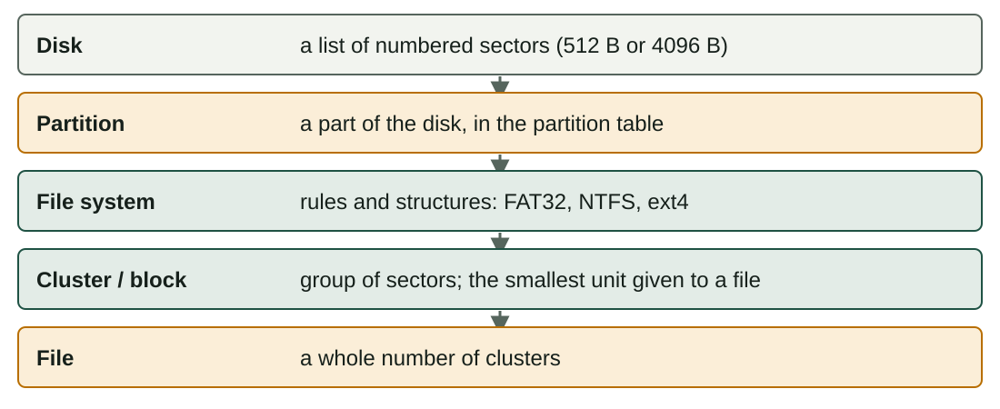
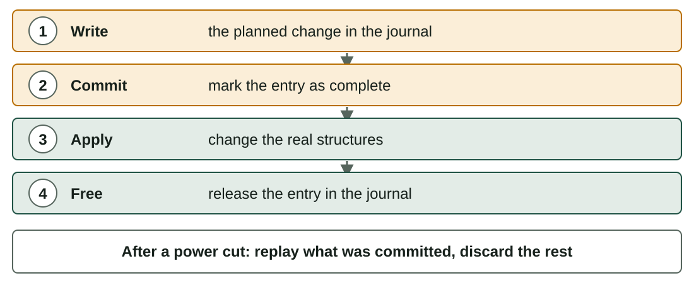

## What you will learn

:::pasos
- How a **disk** is built: sectors and clusters
- **Partitions**, **MBR** and **GPT**
- **FAT32, exFAT, NTFS** and **ext4**, and how to choose
- Why **journaling** saves your data after a power cut
- How to **optimise** storage and write an **installation plan**
:::

---

## Two kinds of disk

| | HDD | SSD |
|---|---|---|
| Technology | Spinning magnetic platters and a moving head | Flash chips, no moving parts |
| Speed | Slow to find data | Very fast, also random access |
| Weak point | Mechanical wear, shocks | Limited writes per cell |
| Fragmentation | Hurts performance | Does not matter |

---

## Physical structure of an HDD

:::pasos
- **Platters** with two faces
- Each face has circular **tracks**, divided into **sectors**
- The same track on all platters is a **cylinder**
- A **sector** is the smallest unit read or written: **512 bytes**, or 4096 in newer disks
:::

---

## Logical structure: clusters and blocks

:::pasos
- The OS works with **clusters** (Windows) or **blocks** (Linux)
- A cluster is a group of **contiguous sectors**
- It is the smallest unit **assigned to a file**
- So a file always uses a **whole number of clusters**
:::

---

## From the disk to your files

---

## The last cluster wastes space

Clusters of 4096 bytes:

| File size (bytes) | Clusters | Space used | Wasted |
|---|---|---|---|
| 1,200 | 1 | 4,096 | 2,896 |
| 5,000 | 2 | 8,192 | 3,192 |
| 9,000 | 3 | 12,288 | 3,288 |
| 40,000 | 10 | 40,960 | 960 |
| **Total 55,200** | **16** | **65,536** | **10,336** |

---

## Choosing the cluster size

:::pasos
- With **32 KiB** clusters the same four files need **5 clusters** and waste **108,640 bytes**
- **Big clusters** waste space with small files
- **Small clusters** need a bigger allocation table
- The size is chosen when you **format**; the default is usually good
:::

---

## Why divide a disk into partitions?

:::pasos
- Install **several operating systems** on one disk
- **Separate** the system from your data: reinstall without touching files
- Use **different file systems**
- Protect the system: a full data partition does not stop the OS
:::

---

## Two partition table formats

---

## MBR (Master Boot Record)

:::pasos
- From the 1980s; works with **BIOS**
- First sector: boot program, **four entries** and a signature
- Maximum **four primary partitions**; or an **extended** one holding **logical** partitions
- Disks limited to **2 TiB**
- Only **one copy** of the table
:::

---

## GPT (GUID Partition Table)

:::pasos
- The modern format, used with **UEFI**
- A **protective MBR** in the first sector, for old tools
- Header and entries (128 by default in Windows), with a **backup copy** at the end
- All partitions of the same kind, each with a **GUID**
- Disks of many terabytes
:::

---

## MBR or GPT?

| | MBR | GPT |
|---|---|---|
| Firmware | BIOS (legacy) | UEFI |
| Partitions | 4 primary, or 3 + extended | Up to 128 in Windows |
| Maximum disk | 2 TiB | Practically unlimited |
| Table copies | 1 | 2 (start and end) |

A UEFI system needs an **EFI System Partition** (FAT32, 100 MB to 1 GB) for the boot loaders.

---

## Names of partitions

:::pasos
- **Windows**: a **drive letter** per volume, `C:`, `D:`…
- **Linux**: a single tree; devices `/dev/sda`, partitions `/dev/sda1`, `/dev/nvme0n1p1`
- To use a partition in Linux, you **mount** it in a folder (`/home`, `/media/usb`)
:::

---

## LVM in Linux

:::pasos
- Join disks or partitions (**physical volumes**) into a **volume group**
- Cut **logical volumes** from it
- You can **extend** a logical volume later, even adding a new disk
- No need to move data
:::

---

## A file system organises the partition

:::pasos
- A partition is empty until you **format** it with a **file system**
- It organises files in **folders**, a tree from the root
- It keeps track of which **clusters** belong to each file and which are free
- It stores **attributes**: name, size, dates, owner, permissions, flags
- Some add **permissions, compression, encryption or a journal**
:::

---

## How each file system finds a file

---

## Comparison (1/2): limits and journal

| | Max file | Max volume | Journal |
|---|---|---|---|
| **FAT32** | 4 GiB − 1 byte | 2 TiB (Windows formats up to 32 GiB) | No |
| **exFAT** | Very large | Very large | No |
| **NTFS** | Limited by the volume | Very large | Yes (metadata) |
| **ext4** | 16 TiB | 1 EiB | Yes |

---

## Comparison (2/2): use

| | Main system | Permissions | Typical use |
|---|---|---|---|
| **FAT32** | Everything (old standard) | No | Small USB, SD cards, EFI partition |
| **exFAT** | Windows, macOS, Linux | No | Big USB drives and SD cards |
| **NTFS** | Windows | Yes (ACL) | Windows system and data disks |
| **ext4** | Linux | Yes (Unix and ACL) | Linux system and data disks |

---

## How to choose

:::pasos
- USB for **Windows, macOS and Linux**, with files over 4 GiB: **exFAT**
- USB for a camera, a TV or an old device: **FAT32**
- Windows system partition, or a data disk with permissions: **NTFS**
- Linux system partition: **ext4**
:::

---

## Compatibility is not complete

:::pasos
- Windows **cannot read ext4** without extra software
- macOS **reads NTFS** but does not write it by default
- Linux reads and writes **NTFS, exFAT and FAT32**
- **ext4** is case-sensitive; the others are not
:::

---

## The problem: a power cut in the middle

:::pasos
- Saving a file needs **several writes**: data, free-space table, directory entry
- A power cut leaves the file system **inconsistent**
- Without a journal, the system checks **the whole disk**: `fsck`, `chkdsk`
- On a big disk it takes long, and does not always repair everything
:::

---

## Journaling: write the plan first

---

## After a power cut

:::pasos
- The system reads the **journal** at the next boot
- Committed but not applied: **replayed**
- Not committed: **discarded**, as if never started
- Consistent again in **seconds**; the price is some **extra writes**
:::

---

## Journaling does not protect everything

:::note[Journaling does not protect everything]
NTFS and ext4 journal mainly **metadata**: the last data you were writing can still be lost.

Journaling does **not replace a backup**.

On FAT32 or exFAT drives, use **Safely remove hardware** or `umount`.
:::

---

## Useful commands and tools

| Task | Linux | Windows |
|---|---|---|
| See disks and partitions | `lsblk`, `sudo fdisk -l` | `diskmgmt.msc`, `diskpart` |
| Free and used space | `df -h`, `du -sh folder` | File Explorer, Settings → Storage |
| Graphic editor | **GParted** | Disk Management |
| Create a file system | `sudo mkfs.ext4 /dev/sdb1` | *Format*, `format` |
| Check and repair | `sudo fsck /dev/sdb1` | `chkdsk D: /f` |

---

## Partitioning and formatting destroy data

:::caution[Partitioning and formatting destroy data]
Practise only in a **virtual machine** with a virtual disk, or on an empty USB drive.

Read the device name **twice**: formatting `/dev/sda` instead of `/dev/sdb` can erase your system.

In GParted, nothing is written until you press **Apply**.
:::

---

## Optimising storage (1/2)

:::pasos
- **Keep free space**: at least 10–15 % on the system partition
- **Clean up**: *Storage Sense*, `du -sh *`, `sudo apt clean`
- **HDD**: defragment (Windows does it automatically)
- **SSD**: **never defragment**; use **TRIM**
- Linux: `sudo fstrim -av`, run weekly by most distributions
:::

---

## Optimising storage (2/2)

:::pasos
- Choose the right **cluster size** and file system for the use
- **Align partitions**: modern tools start at 1 MiB
- **Watch the health**: if a disk fails, **back up first**
- Linux: `smartctl -a /dev/sda` (package `smartmontools`)
:::

---

## The installation plan (1/2)

:::pasos
- **Purpose and users**: what for, who uses it
- **Hardware**: CPU, RAM, disk, drivers, BIOS or UEFI
- **Operating system**: edition, version, 32 or 64 bits, licence
- **Disk**: partition table, partitions, file systems, swap, dual boot
- **Network and name**: computer name, domain, IP address
:::

---

## The installation plan (2/2)

:::pasos
- **Users and security**: administrator, accounts, passwords, firewall, updates
- **Software**: applications and drivers after the system
- **Backup**: what to copy before; how to go back if it fails
- **Checks**: how to test that everything works
:::

---

## Example: Ubuntu Desktop in a virtual machine

4 GiB of RAM and a 40 GiB virtual disk (UEFI):

| Partition | Size | File system | Mount point |
|---|---|---|---|
| EFI System Partition | 512 MiB | FAT32 | `/boot/efi` |
| Root | 25 GiB | ext4 | `/` |
| Swap | 2 GiB | swap | (none) |
| Data | about 12.5 GiB | ext4 | `/home` |

---

## Practise in a virtual machine

:::pasos
- This unit's lab has **no storage tab**
- The activity uses **GParted** with a **virtual disk**
- The installation plan is the base for the activity
:::

---

## Summary

- Disks are divided into **sectors** and the OS assigns **clusters**
- **MBR** (BIOS, 2 TiB, 4 primary) or **GPT** (UEFI, many partitions)
- **exFAT** for several systems, **NTFS** on Windows, **ext4** on Linux
- A **journal** makes recovery fast but is **not a backup**
- **SSD**: TRIM, never defragment; plan before you install

[Activities of the unit →](/docencia/smr/som/ud03-funciones-sistema-operativo/actividades/)

---

## Credits

These slides summarise the SOM course notes by Moisés Mas Rocamora, Daniel Álvarez Santamaría and Jana Taboada León, licensed under **CC BY-NC-SA 4.0**. They are shared under the same licence.
