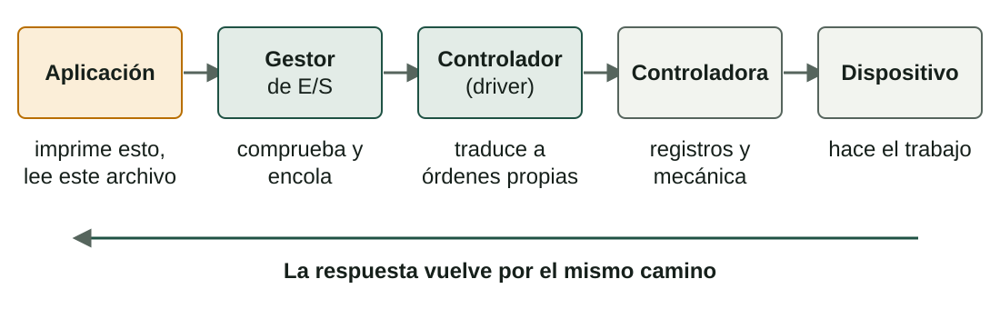
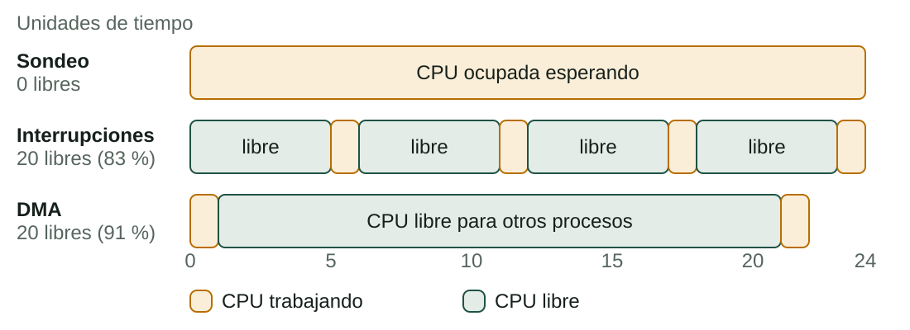
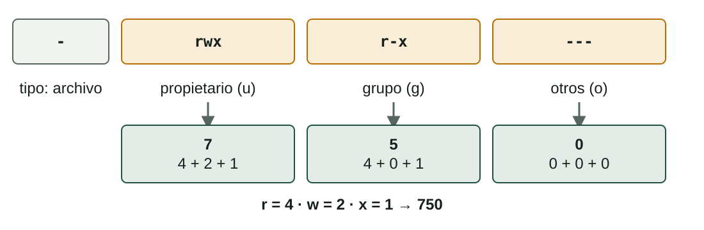
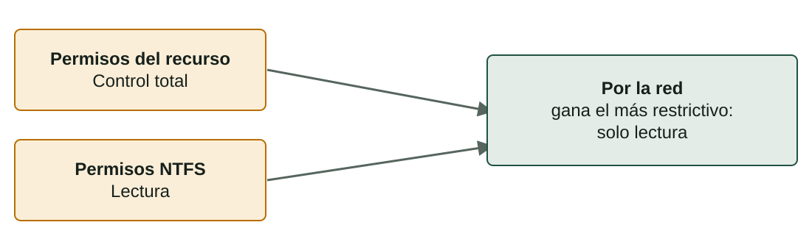

## Qué aprenderás

:::pasos
- Cómo usa una aplicación un **dispositivo** sin saber cómo funciona
- **Sondeo**, **interrupciones** y **DMA**
- **Caché**, **búfer** y **spooling**
- **Seguridad**: autenticación, autorización, mínimo privilegio
- **Permisos** en Linux y NTFS, y **recursos compartidos**
:::

---

## Cómo usa una aplicación un dispositivo



---

## Cada capa oculta diferencias

:::pasos
- El **gestor de E/S** comprueba la petición y la **encola** si el dispositivo está ocupado
- El **controlador** (*driver*) conoce una familia de dispositivos y traduce la petición
- La **controladora** recibe datos y órdenes en sus **registros**
- El resultado vuelve en un **registro de estado** que lee el controlador
:::

---

## Dispositivos como archivos

:::pasos
- Linux muestra muchos dispositivos como archivos en **`/dev`**
- **Dispositivos de bloques**: bloques de datos, como los discos (`/dev/sda`)
- **Dispositivos de caracteres**: un flujo de bytes, como teclados y puertos serie
- Windows lista sus dispositivos en el **Administrador de dispositivos** (`devmgmt.msc`)
:::

---

## Sondeo

:::pasos
- La CPU pregunta una y otra vez al dispositivo: **«¿estás listo?»**
- Sencillo, pero la CPU está en **espera activa**
- Trabaja solo para esperar
:::

---

## Interrupciones

:::pasos
- La CPU inicia la operación y **sigue con otro trabajo**
- El dispositivo envía una **petición de interrupción (IRQ)** cuando está listo
- La CPU guarda su estado, ejecuta la **rutina de tratamiento** y vuelve
- El proceso en espera pasa de **Bloqueado** a **Listo**
:::

---

## DMA: acceso directo a memoria

:::pasos
- Una controladora especial mueve **todo el bloque** entre dispositivo y RAM
- La CPU solo le da la **dirección y el tamaño**
- **Una única interrupción** al final
- La usan discos, tarjetas de red y tarjetas gráficas
:::

---

## ¿Sondeo, interrupciones o DMA?

| | Sondeo | Interrupciones | DMA |
|---|---|---|---|
| Quién copia los datos | CPU | CPU | Controladora DMA |
| CPU mientras tanto | Espera activa | Libre | Libre |
| Interrupciones | Ninguna | Una por dato | Una por transferencia |
| Bueno para | Sistemas simples | Teclados, ratones | Discos, red |

---

## Ejemplo: 4 palabras de un dispositivo lento



---

## Caché, búfer y spooling

| Técnica | Qué es | Ejemplo |
|---|---|---|
| **Caché** | Una copia rápida de datos que usas a menudo | Un archivo leído dos veces sale de la RAM |
| **Búfer** | Zona temporal entre dispositivos de distinta velocidad | Un reproductor de vídeo carga segundos por adelantado |
| **Spooling** | Una **cola de trabajos completos** para un dispositivo que no se puede compartir | La cola de impresión |

---

## Caché: acierto o fallo

:::pasos
- Datos en la caché: un **acierto**; no están: un **fallo**
- Un acierto cuesta 1 unidad; un fallo, 10
- Con **80 % de aciertos**: 0,8 × 1 + 0,2 × 10 = **2,8** unidades
- Casi **cuatro veces más rápido** que leer siempre el dispositivo
:::

---

## Búfer

:::pasos
- Mientras el dispositivo lento llena o vacía el búfer, la **CPU continúa**
- Copiar un archivo grande a una memoria USB: los datos van antes a un **búfer en la RAM**
- Por eso debes **quitar la unidad de forma segura**: el búfer puede no estar vacío
:::

---

## Spooling

:::pasos
- Una impresora imprime **un documento a la vez**, pero muchos quieren imprimir
- Los trabajos esperan en un **spool**: una carpeta en disco
- Un servicio los envía a la impresora **uno a uno**
- Los programas quedan libres enseguida; puedes **ver, pausar o cancelar** trabajos
- Linux: `lpstat -o`
:::

---

## De qué protege la seguridad

:::pasos
- **Errores**: un programa que escribe en memoria que no es suya
- **Mal uso** por un usuario
- **Acceso no autorizado**: físico, por la red o con malware
- **Fallos**
- Ningún sistema es totalmente seguro; los buenos hábitos **reducen el riesgo**
:::

---

## Objetivos de la seguridad

:::pasos
- **Confidencialidad**: solo las personas autorizadas pueden **leer** los datos
- **Integridad**: solo las autorizadas pueden **cambiarlos**, y no por accidente
- **Disponibilidad**: datos y servicios **funcionan cuando los necesitas**
:::

---

## Medidas lógicas y físicas

| Lógicas (software) | Físicas |
|---|---|
| Cuentas con **contraseñas robustas** | Sala o caja cerrada con llave |
| **Permisos** en archivos y carpetas | Control de acceso con tarjetas o huellas |
| Actualizaciones y antivirus | SAI (sistema de alimentación ininterrumpida) |
| Cortafuegos | Cierres de cable, cámaras |
| Cifrado de discos y archivos | Copias de seguridad en otro lugar |

---

## Detrás de cada decisión de acceso

:::pasos
1. **Autenticación**: demostrar quién eres
2. **Autorización**: decidir qué puedes hacer (permisos)
3. **Contabilidad** (*accounting*): guardar un registro de lo ocurrido (logs)
:::

---

## Mínimo privilegio

:::pasos
- Da a cada usuario y programa **solo los derechos que necesita**
- Trabaja con una **cuenta estándar**
- Usa derechos de administrador solo cuando haga falta: **`sudo`**, o la ventana del **UAC** en Windows
- Un programa que abres por error **no puede cambiar archivos del sistema**
:::

---

## Atributos

| Sistema | Atributos | Cómo verlos o cambiarlos |
|---|---|---|
| Windows | *Solo lectura*, *Oculto*, *Sistema*, *Archivo* | Propiedades → General, `attrib +h file.txt` |
| Linux | Un nombre que empieza por punto está oculto; en ext4, indicadores como *immutable* | `ls -a`, `lsattr`, `sudo chattr +i file` |

---

## Permisos en Linux: propietario, grupo, otros



---

## Permisos octales habituales

| Octal | Permisos | Uso típico |
|---|---|---|
| `644` | `rw-r--r--` | Un archivo normal |
| `600` | `rw-------` | Un archivo privado (una clave SSH) |
| `755` | `rwxr-xr-x` | Un programa o carpeta pública |
| `750` | `rwxr-x---` | Un script solo para un grupo |
| `700` | `rwx------` | Una carpeta privada |

---

## Cambiar permisos y propietario

```bash
chmod 640 notes.txt        # rw-r----- (octal)
chmod u+x backup.sh        # añadir ejecución al propietario
chmod g-w,o-rwx report.txt # quitar escritura al grupo y todo a otros
sudo chown student:teachers report.txt   # cambiar propietario y grupo
```

---

## El mismo permiso, distinto significado

| | En un archivo | En un directorio |
|---|---|---|
| `r` | Leer el contenido | Listar los nombres de dentro |
| `w` | Cambiar el contenido | Crear, borrar y renombrar archivos dentro |
| `x` | Ejecutarlo como programa | Entrar (`cd`) y llegar a lo de dentro |

---

## Archivos nuevos y umask

:::pasos
- Los archivos nuevos reciben permisos que dependen de la **`umask`**
- Un valor típico, **`022`**, da **`644`** a los archivos
- Y **`755`** a los directorios
:::

---

## Permisos en Windows (NTFS)

Clic derecho → **Propiedades → Seguridad**.

| Permiso | Qué permite |
|---|---|
| **Lectura** | Ver el contenido y los atributos |
| **Escritura** | Crear archivos y cambiar el contenido |
| **Lectura y ejecución** | Leer y ejecutar programas |
| **Modificar** | Leer, escribir, ejecutar y borrar |
| **Control total** | Todo, incluido cambiar los permisos |

---

## Reglas de NTFS que debes recordar

:::pasos
- Los permisos se **heredan** de la carpeta padre
- Un usuario recibe la **suma** de su entrada y la de todos sus grupos
- Una entrada **Denegar** es más fuerte que una **Permitir**
- `icacls file` los muestra y cambia desde la línea de órdenes
:::

---

## Linux y NTFS, aproximadamente

| Linux | NTFS |
|---|---|
| `r--` | Lectura |
| `r-x` | Lectura y ejecución |
| `rw-` | Modificar (sin ejecución) |
| `rwx` | Control total (más o menos) |
| Propietario / grupo / otros | Cualquier número de usuarios y grupos |

En Linux, las **ACL** (`setfacl`) dan la misma flexibilidad.

---

## Recursos compartidos: Windows

:::pasos
1. Clic derecho en la carpeta → **Propiedades → Compartir → Uso compartido avanzado**
2. Marca **Compartir esta carpeta**, ponle nombre, elige quién la usa y con qué nivel
3. Comprueba los **permisos NTFS** en la pestaña Seguridad
4. Los demás la abren con `\\NOMBREEQUIPO\nombrerecurso`
:::

---

## Permisos del recurso y permisos NTFS a la vez



---

## Recursos compartidos: Linux con Samba

```ini
[documents]
   path = /srv/documents
   read only = no
   valid users = @teachers
```

:::pasos
- **Samba** implementa el protocolo **SMB**, para compartir con Windows
- Reinicia el servicio tras un cambio
- Los clientes conectan con `smb://server/documents`
:::

---

## Buenas prácticas al compartir

:::pasos
- Comparte **solo lo necesario**, no el disco entero
- Da permisos a **usuarios o grupos concretos**, no a *Todos* con *Control total*
- Prefiere **solo lectura** cuando no hace falta escribir
- Sin acceso anónimo o de invitado salvo necesidad; mantén el **cortafuegos** activo
- Revisa de vez en cuando qué está compartido (`net share`)
:::

---

## Juntar las funciones

Imprimir un PDF desde una memoria USB:

:::pasos
- **Sistema de archivos** y **permisos**: encuentran el archivo y te dejan abrirlo
- **Gestor de memoria**: carga el visor
- **Planificador**: reparte la CPU con tu música
- **Gestor de E/S** y **controlador**: hablan con la impresora
- **Spooler**: encola el trabajo
:::

---

## Pruébalo

::laboratorio[Gestor de E/S]{src="planificador-de-procesos" pestana="io"}

---

## Resumen

- El SO oculta los dispositivos tras **gestor de E/S, controlador y controladora**
- Las **interrupciones** liberan la CPU; el **DMA** la libera aún más
- La **caché** copia, el **búfer** suaviza velocidades, el **spooling** encola trabajos
- Seguridad: **autenticación, autorización, mínimo privilegio**
- Permisos: Linux **rwx y octal**, NTFS **permitir y denegar**; comparte solo lo necesario

[Actividades de la unidad →](/docencia/smr/som/ud03-funciones-sistema-operativo/actividades/es/)

---

## Créditos

Estas diapositivas resumen los apuntes del curso de SOM de Moisés Mas Rocamora, Daniel Álvarez Santamaría y Jana Taboada León, con licencia **CC BY-NC-SA 4.0**. Se comparten con la misma licencia.
