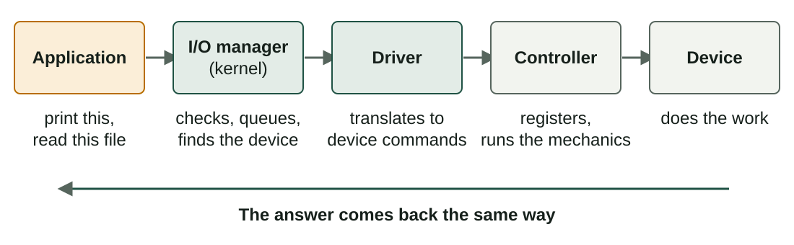
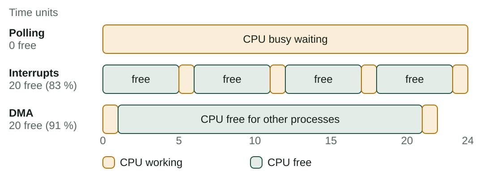
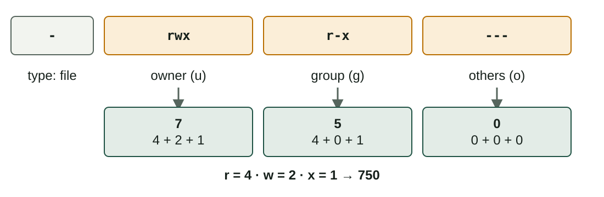
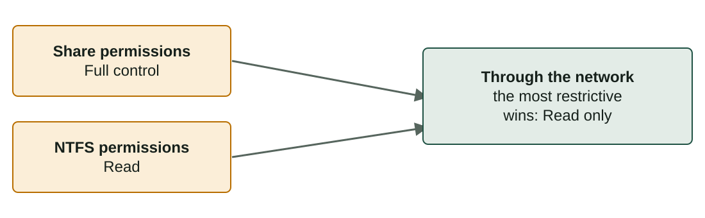

## What you will learn

:::pasos
- How an application uses a **device** without knowing how it works
- **Polling**, **interrupts** and **DMA**
- **Cache**, **buffer** and **spooling**
- **Security**: authentication, authorisation, least privilege
- **Permissions** in Linux and NTFS, and **shared resources**
:::

---

## How an application uses a device



---

## Each layer hides differences

:::pasos
- The **I/O manager** checks the request and **queues** it if the device is busy
- The **driver** knows one family of devices and translates the request
- The **controller** receives data and commands in its **registers**
- The result goes back in a **status register** that the driver reads
:::

---

## Devices as files

:::pasos
- Linux shows many devices as files in **`/dev`**
- **Block devices**: blocks of data, such as disks (`/dev/sda`)
- **Character devices**: a stream of bytes, such as keyboards and serial ports
- Windows lists its devices in **Device Manager** (`devmgmt.msc`)
:::

---

## Polling

:::pasos
- The CPU asks the device again and again: **"are you ready?"**
- Simple, but the CPU is **busy waiting**
- It works only to wait
:::

---

## Interrupts

:::pasos
- The CPU starts the operation and **goes on with other work**
- The device sends an **interrupt request (IRQ)** when ready
- The CPU saves its state, runs the **interrupt handler**, returns
- The waiting process moves from **Waiting** to **Ready**
:::

---

## DMA: Direct Memory Access

:::pasos
- A special controller moves the **whole block** between device and RAM
- The CPU only gives it the **address and size**
- **One single interrupt** at the end
- Used by disks, network cards and graphic cards
:::

---

## Polling, interrupts or DMA?

| | Polling | Interrupts | DMA |
|---|---|---|---|
| Who copies the data | CPU | CPU | DMA controller |
| CPU meanwhile | Busy waiting | Free | Free |
| Interruptions | None | One per piece | One per transfer |
| Good for | Simple systems | Keyboards, mice | Disks, network |

---

## Example: 4 words from a slow device



---

## Cache, buffer and spooling

| Technique | What it is | Example |
|---|---|---|
| **Cache** | A fast copy of data you use often | A file read twice comes from RAM |
| **Buffer** | Temporary area between devices of different speed | A video player loads seconds in advance |
| **Spooling** | A **queue of complete jobs** for a device that cannot be shared | The print queue |

---

## Cache: hit or miss

:::pasos
- Data in the cache: a **hit**; not there: a **miss**
- A hit costs 1 unit; a miss costs 10
- With **80 % hits**: 0.8 × 1 + 0.2 × 10 = **2.8** units
- Nearly **four times faster** than always reading the device
:::

---

## Buffer

:::pasos
- While the slow device fills or empties the buffer, the **CPU continues**
- Copying a big file to a USB drive: the data goes first to a **buffer in RAM**
- That is why you must **safely remove** the drive: the buffer may not be empty
:::

---

## Spooling

:::pasos
- A printer prints **one document at a time**, but many want to print
- Jobs wait in a **spool**: a folder on disk
- A service sends them to the printer **one by one**
- Programs are free at once; you can **see, pause or cancel** jobs
- Linux: `lpstat -o`
:::

---

## What security protects against

:::pasos
- **Errors**: a program writing in memory that is not its own
- **Misuse** by a user
- **Unauthorised access**: physical, through the network, or malware
- **Faults**
- No system is completely secure; good habits **reduce the risk**
:::

---

## Aims of security

:::pasos
- **Confidentiality**: only authorised people can **read** the data
- **Integrity**: only authorised people can **change** it, and not by accident
- **Availability**: data and services **work when you need them**
:::

---

## Logical and physical measures

| Logical (software) | Physical |
|---|---|
| Accounts with **strong passwords** | Locked room or case |
| **Permissions** on files and folders | Access control with cards or fingerprints |
| Updates and antivirus | UPS (uninterruptible power supply) |
| Firewall | Cable locks, cameras |
| Encryption of disks and files | Backups kept in another place |

---

## Behind every access decision

:::pasos
1. **Authentication**: proving who you are
2. **Authorisation**: deciding what you may do (permissions)
3. **Accounting**: keeping a record of what happened (logs)
:::

---

## Least privilege

:::pasos
- Give each user and program **only the rights they need**
- Work with a **standard account**
- Use admin rights only when needed: **`sudo`**, or the **UAC** window in Windows
- A program you open by mistake **cannot change system files**
:::

---

## Attributes

| System | Attributes | How to see or change |
|---|---|---|
| Windows | *Read-only*, *Hidden*, *System*, *Archive* | Properties → General, `attrib +h file.txt` |
| Linux | A name starting with a dot is hidden; ext4 flags such as *immutable* | `ls -a`, `lsattr`, `sudo chattr +i file` |

---

## Permissions in Linux: owner, group, others



---

## Common octal permissions

| Octal | Permissions | Typical use |
|---|---|---|
| `644` | `rw-r--r--` | A normal file |
| `600` | `rw-------` | A private file (an SSH key) |
| `755` | `rwxr-xr-x` | A program or public folder |
| `750` | `rwxr-x---` | A script for a group only |
| `700` | `rwx------` | A private folder |

---

## Changing permissions and owner

```bash
chmod 640 notes.txt        # rw-r----- (octal)
chmod u+x backup.sh        # add execute for the owner
chmod g-w,o-rwx report.txt # remove write from the group, all from others
sudo chown student:teachers report.txt   # change owner and group
```

---

## The same permission, different meaning

| | On a file | On a directory |
|---|---|---|
| `r` | Read the content | List the names inside |
| `w` | Change the content | Create, delete, rename files inside |
| `x` | Run it as a program | Enter it (`cd`) and reach what is inside |

---

## New files and umask

:::pasos
- New files get permissions that depend on the **`umask`**
- A typical value, **`022`**, gives **`644`** to files
- And **`755`** to directories
:::

---

## Permissions in Windows (NTFS)

Right click → **Properties → Security**.

| Permission | What it allows |
|---|---|
| **Read** | See the content and attributes |
| **Write** | Create files and change the content |
| **Read & execute** | Read and run programs |
| **Modify** | Read, write, execute and delete |
| **Full control** | Everything, including changing permissions |

---

## NTFS rules to remember

:::pasos
- Permissions are **inherited** from the parent folder
- A user gets the **sum** of their own entry and all their groups
- A **Deny** entry is stronger than an **Allow** one
- `icacls file` shows and changes them from the command line
:::

---

## Linux and NTFS, approximately

| Linux | NTFS |
|---|---|
| `r--` | Read |
| `r-x` | Read & execute |
| `rw-` | Modify (without execute) |
| `rwx` | Full control (roughly) |
| Owner / group / others | Any number of users and groups |

In Linux, **ACLs** (`setfacl`) give the same flexibility.

---

## Shared resources: Windows

:::pasos
1. Right click the folder → **Properties → Sharing → Advanced Sharing**
2. Tick **Share this folder**, name it, choose who can use it and the level
3. Check the **NTFS permissions** in the Security tab
4. Others open it with `\\COMPUTERNAME\sharename`
:::

---

## Share permissions and NTFS permissions together



---

## Shared resources: Linux with Samba

```ini
[documents]
   path = /srv/documents
   read only = no
   valid users = @teachers
```

:::pasos
- **Samba** implements the **SMB** protocol, to share with Windows
- Restart the service after a change
- Clients connect with `smb://server/documents`
:::

---

## Good practices when sharing

:::pasos
- Share **only what is needed**, not the entire disk
- Give permissions to **specific users or groups**, not *Everyone* with *Full control*
- Prefer **read-only** when users do not need to write
- No anonymous or guest access unless needed; keep the **firewall** active
- Check from time to time what is shared (`net share`)
:::

---

## Putting the functions together

Printing a PDF from a USB drive:

:::pasos
- **File system** and **permissions**: find the file and let you open it
- **Memory manager**: loads the viewer
- **Scheduler**: shares the CPU with your music
- **I/O manager** and **driver**: talk to the printer
- **Spooler**: queues the job
:::

---

## Try it yourself

::laboratorio[I/O manager]{src="planificador-de-procesos" pestana="io"}

---

## Summary

- The OS hides devices behind **I/O manager, driver and controller**
- **Interrupts** free the CPU; **DMA** frees it even more
- **Cache** copies, **buffer** smooths speeds, **spooling** queues jobs
- Security: **authentication, authorisation, least privilege**
- Permissions: Linux **rwx and octal**, NTFS **allow and deny**; share only what is needed

[Activities of the unit →](/docencia/smr/som/ud03-funciones-sistema-operativo/actividades/)

---

## Credits

These slides summarise the SOM course notes by Moisés Mas Rocamora, Daniel Álvarez Santamaría and Jana Taboada León, licensed under **CC BY-NC-SA 4.0**. They are shared under the same licence.
